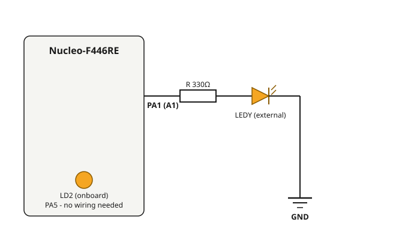

# 1 — Blink LED (dual LED, non-blocking timing)

**Board:** Nucleo-F446RE (STM32F446RETx)
**IDE:** STM32CubeIDE (GCC / make)

## Learning goal

This project teaches **non-blocking timing**: how to run two timed tasks at different rates without stopping the CPU.

After this project you can:
- explain why `HAL_Delay()` blocks the whole program
- use `HAL_GetTick()` to time several tasks independently
- configure GPIO outputs and user labels in CubeMX

## Overview

Two LEDs blink at two different rates inside the same `while(1)` loop:
- **LD2** — the LED built into the Nucleo board (`PA5`). No wiring needed.
- **LEDY** — an external LED wired to `PA1`.

## Theory

### Blocking vs non-blocking delay

`HAL_Delay()` **blocks**: the CPU sits inside the function until the time is up, so nothing else can run. Blink LD2 with it and LEDY cannot blink at the same time.

The alternative is to read `HAL_GetTick()`, a millisecond counter driven by the SysTick timer, and compare it with a timestamp. Each LED stores the time of its last toggle and toggles again only when *its own* interval has elapsed. The loop never waits, so both LEDs run independently.

This "record a timestamp, keep checking the elapsed time" pattern is the foundation of every later project in this repository (debounce timers, double-click windows, long-press detection, sensor timing).

## Hardware & wiring

| Signal | Pin | Notes |
|---|---|---|
| `LD2` | PA5 | Onboard user LED, no external wiring |
| `LEDY` | PA1 | External LED, active-high through a series resistor |



LD2 needs no wiring. For `LEDY`: `PA1` → resistor (≈330Ω) → LED anode, LED cathode → `GND`.

## CubeMX setup

1. `File → New → STM32 Project` → Board Selector → **NUCLEO-F446RE** → Next → finish the wizard.
2. Click pin **PA1** → set it to `GPIO_Output`, and set **User Label** to `LEDY`.
3. `PA5` is already `GPIO_Output` labelled `LD2` (the board selector recognises the onboard LED). Nothing to change.
4. **Project Manager → Project** → Toolchain / IDE = `STM32CubeIDE`.
5. **Project Manager → Code Generator** → **`Copy only the necessary library files`** (the other option pulls in CMSIS submodules that fail to compile).
6. **GENERATE CODE**.

## Code

All the application code is in `Core/Src/main.c`, inside the `USER CODE` markers. `MX_GPIO_Init()` (generated) sets both pins as push-pull outputs.

```c
/* USER CODE BEGIN PV */
uint32_t time_LD2  = 0;   // timestamp of the last LD2 toggle
uint32_t time_LEDY = 0;   // timestamp of the last LEDY toggle
/* USER CODE END PV */

/* USER CODE BEGIN 3 */
if (HAL_GetTick() - time_LD2 >= 200)       // LD2: every 200ms
{
  HAL_GPIO_TogglePin(LD2_GPIO_Port, LD2_Pin);
  time_LD2 = HAL_GetTick();
}
if (HAL_GetTick() - time_LEDY >= 1000)     // LEDY: every 1000ms
{
  HAL_GPIO_TogglePin(LEDY_GPIO_Port, LEDY_Pin);
  time_LEDY = HAL_GetTick();
}
/* USER CODE END 3 */
```

The subtraction `HAL_GetTick() - time_...` stays correct even when the 32-bit counter wraps around, which is why it is written this way instead of comparing against `time_... + interval`.

## Folder structure

```
1_Blink_LED/
├── Core/Src/main.c        - the two independent timers in the while(1) loop
├── blink_led_new.ioc      - CubeMX pin configuration
└── wiring_diagram.svg
```
