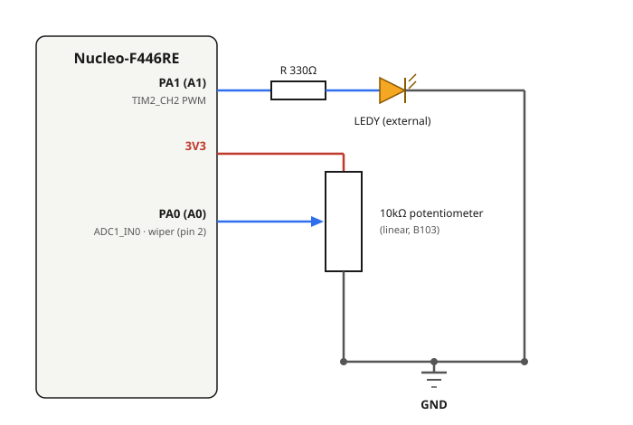

# 4.1 — ADC Single Channel + PWM LED (potentiometer → brightness)

**Board:** Nucleo-F446RE (STM32F446RETx)
**IDE:** STM32CubeIDE (GCC / make)

## Learning goal

This project teaches **how to read an analog voltage with the ADC and produce an analog-like output with timer PWM**.

After this project you can:
- read a potentiometer with a single-channel ADC conversion
- calculate PWM frequency and duty cycle from Prescaler, Counter Period and `CCR`
- map a 12-bit ADC value onto a PWM duty value

## Overview

A 10kΩ potentiometer is read on one ADC channel and its value sets the LED brightness through PWM: turn the knob and the LED dims or brightens in real time. It is the first project that combines two peripherals, the **ADC** and a **timer in PWM mode**.

## Theory

### Reading the ADC

The ADC runs in **single conversion mode** (`ContinuousConvMode = DISABLE`), so every reading is an explicit start, wait, read, stop cycle. A conversion takes only a few microseconds, so blocking while it finishes is fine here. The result is 12-bit: 0 to 4095 for 0V to 3.3V.

### Timer clock: Prescaler and Counter Period

The timer counter `CNT` is driven by hardware. It increments once per **counter tick**, and when it reaches the Counter Period it returns to 0 and generates an **Update event**; then the cycle repeats.

```
Counter clock       = Timer input clock / (Prescaler + 1)
Counter tick period = 1 / Counter clock
Update event period = Counter tick period × (Counter Period + 1)
PWM frequency       = 1 / Update event period
```


TIM2 is on APB1, whose timer clock on this board is **90MHz**. With `Prescaler = 89` and `Counter Period = 999`:

```
Counter clock       = 90,000,000 / (89 + 1) = 1MHz      → 1µs per tick
Update event period = 1µs × (999 + 1) = 1ms
PWM frequency       = 1kHz
```

`Prescaler = 89` gives a clean 1µs tick, and `Counter Period = 999` gives 1000 duty steps. The 1µs is only how fast the counter ticks, not the LED blink rate: the LED's on/off cycle is the whole 1ms period, 1000 times a second, far above the 50 to 60Hz at which the eye sees flicker.

### Duty cycle sets brightness

The `CCR` (Capture/Compare Register) holds the value written by `__HAL_TIM_SET_COMPARE()`. In PWM mode 1 with `OCPolarity = High`, the pin is HIGH while `CNT < CCR` and LOW for the rest of the period:


```
Duty cycle (%) = CCR / (Counter Period + 1) × 100%
```

The PWM frequency is fixed by Prescaler and Counter Period at startup and never changes. Only `CCR` changes, which changes how much of each 1ms period the LED is on, and that is perceived as brightness.

## Hardware & wiring

| Signal | Pin | Notes |
|---|---|---|
| Potentiometer wiper | PA0 (Arduino header **A0**), `ADC1_IN0` | Analog input, 12-bit, single channel, software-triggered |
| LEDY (PWM) | PA1 (Arduino header **A1**), `TIM2_CH2` | Alternate-function output, 1kHz PWM |



- Potentiometer (10kΩ linear, marked **B103**): outer pins to `3V3` and `GND` (swapping them only reverses the direction), wiper (middle pin) to `PA0`.
- LEDY: `PA1` → resistor (~330Ω) → LED anode, LED cathode → `GND`.

## CubeMX setup

1. `File → New → STM32 Project` → Board Selector → **NUCLEO-F446RE** → Next → finish the wizard.
2. Click pin **PA0** → `ADC1_IN0`.
3. **Analog → ADC1**: tick only `IN0` (single channel, no Scan Mode). **Resolution** = `12-bit`, **Data Alignment** = `Right Alignment`, **Continuous Conversion Mode** = `Disabled`, **Sampling Time** = `56 Cycles`.
4. Click pin **PA1** → `TIM2_CH2`.
5. **Timers → TIM2** → **Channel2** = `PWM Generation CH2`. **Prescaler** = `89`, **Counter Period (ARR)** = `999`, **Pulse** = `0`.
6. **Project Manager → Project** → Toolchain / IDE = `STM32CubeIDE` (another toolchain produces a project the CubeIDE import wizard cannot see).
7. **Project Manager → Code Generator** → **`Copy only the necessary library files`**.
8. **GENERATE CODE**.

## Code

```c
/* USER CODE BEGIN PV */
uint32_t adc_raw = 0;
uint32_t duty = 0;
/* USER CODE END PV */

/* USER CODE BEGIN 2 */
HAL_TIM_PWM_Start(&htim2, TIM_CHANNEL_2);   // once: the timer then outputs PWM in hardware
/* USER CODE END 2 */

while (1)
{
  HAL_ADC_Start(&hadc1);
  HAL_ADC_PollForConversion(&hadc1, HAL_MAX_DELAY);   // wait for the end-of-conversion flag
  adc_raw = HAL_ADC_GetValue(&hadc1);                 // 0..4095
  HAL_ADC_Stop(&hadc1);

  duty = adc_raw * 999 / 4095;                         // map 0..4095 to 0..999
  __HAL_TIM_SET_COMPARE(&htim2, TIM_CHANNEL_2, duty);  // writes TIM2->CCR2
}
```

The PWM is started once. The loop only rewrites the compare register; the timer keeps generating the signal on its own. To watch `adc_raw` and `duty` while the program runs, add them to CubeIDE's **Live Expressions** view during a debug session.

## Folder structure

```
4_1_ADC_LED/
├── Core/Src/main.c              - MX_ADC1_Init, MX_TIM2_Init, loop reading the ADC and writing the PWM compare
├── 4_1_ADC_LED.ioc              - CubeMX project (ADC1 IN0 single channel, TIM2 CH2 PWM)
├── wiring_diagram.svg
├── timer_prescaler_diagram.svg  - how Prescaler and Counter Period set the 1kHz
└── pwm_duty_diagram.svg         - how CCR sets the duty cycle
```
