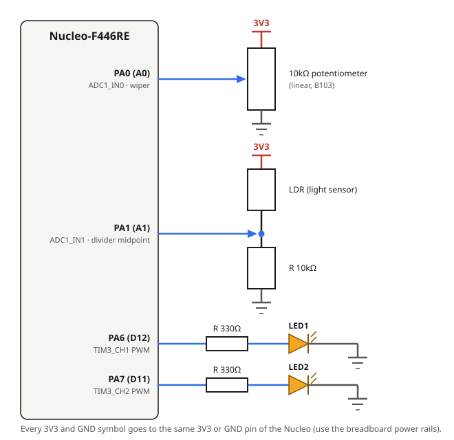

# 4.2 — Multi-channel ADC (hardware scan + DMA) + 2 LED PWM

**Board:** Nucleo-F446RE (STM32F446RETx)
**IDE:** STM32CubeIDE (GCC / make)

## Learning goal

This project teaches **how to read several analog inputs at once with ADC scan mode and DMA**, without the CPU doing any of the conversions.

After this project you can:
- explain what the ADC sequencer (scan mode) and DMA each do
- configure ADC scan, continuous mode and circular DMA in CubeMX
- drive two independent PWM outputs from two sensors in one loop

## Overview

A potentiometer and a light-dependent resistor (LDR) are read on the **same ADC** at the same time. Each channel sets the brightness of its own LED through PWM: LED1 follows the potentiometer, LED2 follows ambient light. It extends [4_1_ADC_LED](../4_1_ADC_LED), which reads a single channel by polling.

## Theory

### ADC scan + DMA


The ADC's **regular group sequencer** holds an ordered list of channels, a "rank" table (Rank 1 = channel 0, Rank 2 = channel 1). With **Scan Mode** on, one `HAL_ADC_Start_DMA()` call makes the ADC step through the whole list by itself. With **Continuous Mode** on, it loops back to Rank 1 after the last rank and repeats forever.

Each time a conversion finishes, the **DMA controller** (not the CPU) copies the result from `ADC1->DR` into a RAM array. In **Circular** mode it wraps back to the start after the last slot, staying in step with the sequencer.

From then on the array keeps updating in the background. The `while(1)` loop never calls `Start`, `PollForConversion`, `GetValue` or `Stop`; it just reads what is already in the array.

### Two PWM channels

The same PWM method as [4_1_ADC_LED](../4_1_ADC_LED), on two channels of one timer (TIM3). With `Prescaler = 89` and `Counter Period = 999`, the 90MHz timer clock gives a 1kHz PWM on both channels, fast enough that neither LED visibly flickers.

## Hardware & wiring

| Signal | Pin | Notes |
|---|---|---|
| Potentiometer wiper | PA0-WKUP (Arduino header **A0**), `ADC1_IN0` | Rank 1 |
| LDR divider midpoint | PA1 (Arduino header **A1**), `ADC1_IN1` | Rank 2 |
| LED1 (PWM) | PA6 (Arduino header **D12**), `TIM3_CH1` | Follows the potentiometer |
| LED2 (PWM) | PA7 (Arduino header **D11**), `TIM3_CH2` | Follows the LDR |



- **Potentiometer** (10kΩ linear, marked **B103**): outer pins to `3V3` and `GND`, wiper to `PA0`.
- **LDR divider**: `3V3` → LDR → node → 10kΩ resistor → `GND`; the node goes to `PA1`. `V(PA1) = 3.3V × R_fixed / (R_LDR + R_fixed)`, so more light means lower `R_LDR` and a higher reading.
- **LED1 / LED2**: `PA6` / `PA7` → 330Ω → LED anode, LED cathode → `GND`.

An LDR has only two legs, so the fixed resistor is what turns its resistance change into a voltage the ADC can read. Without it the pin would sit near 3V3 whatever the light level.

## CubeMX setup

1. `File → New → STM32 Project` → Board Selector → **NUCLEO-F446RE** → Next → finish the wizard.
2. Click pin **PA0** → `ADC1_IN0`, **PA1** → `ADC1_IN1`, **PA6** → `TIM3_CH1`, **PA7** → `TIM3_CH2`.
3. **Analog → ADC1**: tick `IN0` and `IN1`, then:
   - **Scan Conversion Mode** = `Enabled`, **Continuous Conversion Mode** = `Enabled`
   - **DMA Continuous Requests** = `Enabled`. Easy to miss: without it DMA does one scan at startup and the buffer never updates again
   - **Resolution** = `12-bit`, **Data Alignment** = `Right Alignment`, **Number Of Conversion** = `2`
   - Rank 1 = `IN0`, Rank 2 = `IN1`, both **Sampling Time** = `56 Cycles`
4. In ADC1's **DMA Settings** tab → **Add** → `ADC1`:
   - **Mode** = `Circular` (otherwise DMA also stops after one pass)
   - **Data Width**: Peripheral = `Half Word`, Memory = `Half Word`
   - **Memory** → tick **Increment Address** (leave Peripheral unticked: `ADC1->DR` never moves)
5. **Timers → TIM3** → **Channel1** = `PWM Generation CH1`, **Channel2** = `PWM Generation CH2`. **Prescaler** = `89`, **Counter Period (ARR)** = `999` (the default 65535 gives a ~15Hz PWM with visible flicker), **Pulse** = `0` on both.
6. **Project Manager → Project** → Toolchain / IDE = `STM32CubeIDE`.
7. **Project Manager → Code Generator** → **`Copy only the necessary library files`**.
8. **GENERATE CODE**.

## Code

Build it in stages and test each one on hardware. First start only the DMA and check `adc_buf[0]` and `adc_buf[1]` in Live Expressions: the pot should change only `[0]`, covering the LDR only `[1]`. Then test the PWM alone with a fixed `CCR` of 500 (both LEDs at about 50%). Then combine:

```c
/* USER CODE BEGIN PV */
uint16_t adc_buf[2] = {0};      // adc_buf[0] = IN0 (pot), adc_buf[1] = IN1 (LDR)
uint32_t duty1 = 0, duty2 = 0;
/* USER CODE END PV */

/* USER CODE BEGIN 2 */
HAL_ADC_Start_DMA(&hadc1, (uint32_t*)adc_buf, 2);   // once: ADC + DMA now run on their own
HAL_TIM_PWM_Start(&htim3, TIM_CHANNEL_1);
HAL_TIM_PWM_Start(&htim3, TIM_CHANNEL_2);
/* USER CODE END 2 */

while (1)
{
  duty1 = adc_buf[0] * 999 / 4095;
  duty2 = adc_buf[1] * 999 / 4095;
  __HAL_TIM_SET_COMPARE(&htim3, TIM_CHANNEL_1, duty1);
  __HAL_TIM_SET_COMPARE(&htim3, TIM_CHANNEL_2, duty2);
}
```

The two LEDs respond independently in one loop with no delay or blocking call, because reading the sensors no longer happens in software.

## Folder structure

```
4_2_Multi_ADC_LED/
├── Core/Src/main.c              - MX_ADC1_Init, MX_TIM3_Init, MX_DMA_Init,
│                                   loop mapping adc_buf[] to PWM duty
├── 4_2_Multi_ADC_LED.ioc        - CubeMX project (ADC1 IN0+IN1 scan + DMA circular,
│                                   TIM3 CH1+CH2 PWM)
├── adc_scan_dma_diagram.svg     - hardware scan + DMA sequence
└── wiring_diagram.svg
```
