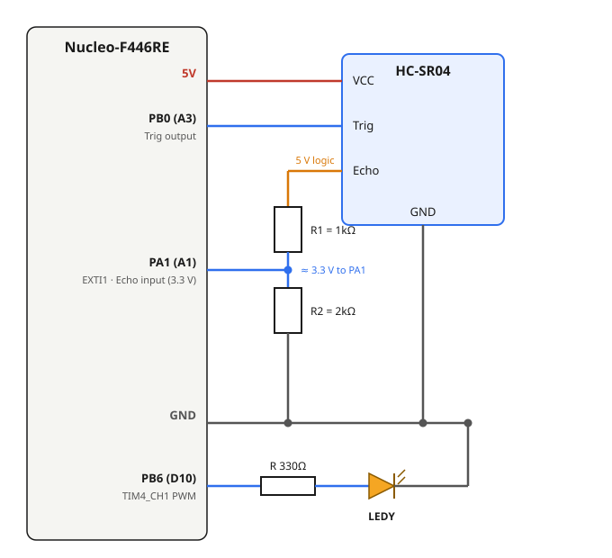

# 5 — Timer + Interrupt: HC-SR04 Ultrasonic Distance → LED Brightness

**Board:** Nucleo-F446RE (STM32F446RETx)
**IDE:** STM32CubeIDE (GCC / make)

## Learning goal

This project teaches **how to use timers and interrupts together to measure time precisely**, using an HC-SR04 ultrasonic sensor, without `HAL_Delay()` or busy-polling.

After this project you can:
- measure a pulse width with a free-running timer and an EXTI interrupt
- explain why three timers are used and what each one does
- calculate timer settings from Prescaler and Counter Period
- keep a sensor driver in its own module, separate from the application

## Overview

An HC-SR04 measures the distance to an object and the LED brightness follows it: bring your hand closer and the LED gets brighter, pull it away and it dims. The whole pipeline is built from timer and interrupt primitives:

| Timer / interrupt | Role |
|---|---|
| **TIM3** | Free-running 1µs counter (no interrupt): shared timebase for `delay_us()` and for timestamping the Echo pulse |
| **TIM6** | Update interrupt every 60ms: schedules each ranging cycle |
| **EXTI1 (PA1)** | External interrupt, both edges: catches the Echo pin's rising and falling edges |
| **TIM4 CH1** | PWM, 1kHz: turns the distance into LED brightness |

## Theory

### How the HC-SR04 works

The sensor has four pins: `VCC` (5V), `GND`, `Trig` (input) and `Echo` (output). Range is 2 to 400cm. It does nothing on its own: it waits for the MCU to drive `Trig`.

Hold `Trig` HIGH for at least 10µs and the sensor sends an 8-cycle 40kHz ultrasonic burst. Right after, `Echo` goes HIGH and stays HIGH until the reflection returns, then goes LOW. The time `T` that `Echo` stays HIGH is the round-trip time of the sound, so it is proportional to the distance:

```
S = v × T / 2 = 340 m/s × (T in µs) / 1,000,000 / 2 = 0.017 × T   (cm)
```

`v` is the speed of sound and the `/2` accounts for the trip to the object **and back**. The datasheet bounds `T`: about 118µs at 2cm, 23.5ms at 400cm, and `Echo` drops by itself after about 38ms if nothing is in range.


### Why three timers


- **TIM6 decides WHEN to measure.** It drives no pin; its Update interrupt every 60ms calls `Sensor_Trigger()`. The HC-SR04 needs at least 60ms between triggers so the previous echo has died out.
- **TIM3 measures HOW LONG.** A free-running counter, started once and never reset. `delay_us()` uses it for the 10µs `Trig` pulse, and the EXTI callback uses it to timestamp both Echo edges. Both just read `CNT` at different moments and subtract.
- **TIM4 outputs the RESULT.** It knows nothing about the sensor: it receives a `duty` value each cycle and free-runs the PWM in hardware.

### Timer settings

TIM3, TIM4 and TIM6 are on APB1, where the timer clock is **90MHz**:

```
Counter clock = Timer input clock / (PSC + 1)
Tick period   = 1 / Counter clock
Update period = Tick period × (ARR + 1)
```

| Timer | PSC | ARR | Result |
|---|---|---|---|
| TIM3 | 89 | 65535 | 1MHz → 1µs per tick; `CNT` wraps after 65.5ms, longer than the 38ms no-echo timeout |
| TIM6 | 8999 | 599 | 10kHz → 0.1ms per tick × 600 = **60ms** Update period |
| TIM4 | 89 | 999 | 1MHz / 1000 steps = **1kHz** PWM, 1000 brightness steps |

## Hardware & wiring

| Signal | Nucleo pin | Notes |
|---|---|---|
| HC-SR04 `VCC` | 5V | |
| HC-SR04 `GND` | GND | |
| HC-SR04 `Trig` | PB0 (**A3** on the Arduino header) | Direct: the sensor reads a 3.3V HIGH fine |
| HC-SR04 `Echo` | PA1 (**A1**), through a **1kΩ/2kΩ divider** | Do **not** connect straight to PA1 |
| LEDY (PWM) | PB6 (**D10**), `TIM4_CH1` | Through a ~330Ω resistor to GND |



- **Check the silkscreen against the pin.** On the Nucleo-F446RE, `A0` = PA0 and `A3` = PB0. `Trig` goes to **A3**, not A0.
- **Echo needs a voltage divider.** The sensor's logic is 5V, and a 5V signal can exceed the STM32's 3.3V GPIO tolerance. Wire `Echo → 1kΩ → node → 2kΩ → GND` and tap `PA1` from the node: `5V × 2kΩ / (1kΩ + 2kΩ) ≈ 3.3V`.

## CubeMX setup

1. `File → New → STM32 Project` → Board Selector → **NUCLEO-F446RE** → Next → finish the wizard.
2. **Pinout view:**
   - **PB0** → `GPIO_Output`, label `TRIG`.
   - **PA1** → `GPIO_EXTI1`, label `ECHO`. **GPIO Mode** = `External Interrupt Mode with Rising/Falling edge trigger detection` (both edges: start and end of the pulse), **Pull-up/Pull-down** = `No pull`.
   - **PB6** → `TIM4_CH1`.
3. **Timers → TIM3**: tick **Activated** under Clock Source (base timer only, all channels `Disable`). **Prescaler** = `89`, **Counter Mode** = `Up`, **Counter Period** = `65535`, **auto-reload preload** = `Disable`.
4. **Timers → TIM4**: **Channel1** = `PWM Generation CH1`. **Prescaler** = `89`, **Counter Period** = `999`, **Pulse** = `0`.
5. **Timers → TIM6**: tick **Activated**. **Prescaler** = `8999`, **Counter Period** = `599`.
6. **System Core → NVIC**: confirm **TIM6 global interrupt** and **EXTI line1 interrupt** are enabled. Without them neither callback runs.
7. **Project Manager → Project** → Toolchain / IDE = `STM32CubeIDE`.
8. **Project Manager → Code Generator** → **`Copy only the necessary library files`**.
9. **GENERATE CODE**.

## Code

### Sensor module (`lib/sensor.h`, `lib/sensor.c`)

The driver is hand-written, not generated, and handles **sensor signal processing only**: Trig, Echo and a distance in cm. It knows nothing about LEDs or PWM; the brightness mapping stays in `main.c`.

To make CubeIDE build `lib/`: add `../lib` under **Properties → C/C++ Build → Settings → MCU GCC Compiler → Include paths**, and add the `lib` folder under **C/C++ General → Paths and Symbols → Source Location** (once per configuration, Debug and Release).

**`sensor.h`**

```c
void Sensor_Init(TIM_HandleTypeDef *htim_us,
                 GPIO_TypeDef *trig_port, uint16_t trig_pin,
                 GPIO_TypeDef *echo_port, uint16_t echo_pin);
void Sensor_Trigger(void);                      // call every 60ms (from TIM6's callback)
void Sensor_EXTI_Callback(uint16_t GPIO_Pin);   // forward every EXTI interrupt here
uint32_t Sensor_GetDistanceCm(void);            // latest result, safe to call anytime
```

**`sensor.c`**

```c
void Sensor_Init(TIM_HandleTypeDef *htim_us,
                 GPIO_TypeDef *trig_port, uint16_t trig_pin,
                 GPIO_TypeDef *echo_port, uint16_t echo_pin)
{
  s_htim_us   = htim_us;     // parameters are local, so keep them in static variables
  s_trig_port = trig_port;
  s_trig_pin  = trig_pin;
  s_echo_port = echo_port;
  s_echo_pin  = echo_pin;

  HAL_TIM_Base_Start(s_htim_us);   // TIM3 starts free-running
}

static void delay_us(uint16_t us)   // busy-wait on TIM3's counter, never resets it
{
  uint16_t start = (uint16_t)__HAL_TIM_GET_COUNTER(s_htim_us);
  while ((uint16_t)((uint16_t)__HAL_TIM_GET_COUNTER(s_htim_us) - start) < us)
  {
  }
}

void Sensor_Trigger(void)
{
  if (s_measurement_busy) return;    // ignore if the previous echo has not finished
  s_measurement_busy = 1;

  HAL_GPIO_WritePin(s_trig_port, s_trig_pin, GPIO_PIN_SET);
  delay_us(TRIG_PULSE_US);           // 10µs
  HAL_GPIO_WritePin(s_trig_port, s_trig_pin, GPIO_PIN_RESET);
}

void Sensor_EXTI_Callback(uint16_t GPIO_Pin)
{
  if (GPIO_Pin != s_echo_pin) return;

  if (HAL_GPIO_ReadPin(s_echo_port, s_echo_pin) == GPIO_PIN_SET)
  {
    s_echo_start = __HAL_TIM_GET_COUNTER(s_htim_us);          // rising edge
  }
  else
  {
    s_echo_end = __HAL_TIM_GET_COUNTER(s_htim_us);            // falling edge
    uint16_t pulse_width_us = (uint16_t)(s_echo_end - s_echo_start);

    uint32_t distance = (uint32_t)(0.017f * (float)pulse_width_us);
    if (distance < SENSOR_MIN_CM) distance = SENSOR_MIN_CM;
    if (distance > SENSOR_MAX_CM) distance = SENSOR_MAX_CM;
    s_distance_cm = distance;

    s_measurement_busy = 0;
  }
}
```

`Sensor_GetDistanceCm()` returns `s_distance_cm`.

### `main.c`

```c
#include "sensor.h"

#define LED_ACTIVE_RANGE_CM 50   // beyond this distance the LED is fully off
#define PWM_MAX_DUTY        999

/* After the MX_..._Init() calls */
Sensor_Init(&htim3, TRIG_GPIO_Port, TRIG_Pin, ECHO_GPIO_Port, ECHO_Pin);
HAL_TIM_PWM_Start(&htim4, TIM_CHANNEL_1);
HAL_TIM_Base_Start_IT(&htim6);

while (1)
{
  uint32_t distance_cm = Sensor_GetDistanceCm();
  uint32_t led_cm = (distance_cm > LED_ACTIVE_RANGE_CM) ? LED_ACTIVE_RANGE_CM : distance_cm;
  uint32_t duty = PWM_MAX_DUTY - ((led_cm - 2) * PWM_MAX_DUTY / (LED_ACTIVE_RANGE_CM - 2));
  __HAL_TIM_SET_COMPARE(&htim4, TIM_CHANNEL_1, duty);
}

/* The only two places where TIM6 and EXTI reach the driver */
void HAL_GPIO_EXTI_Callback(uint16_t GPIO_Pin)
{
  Sensor_EXTI_Callback(GPIO_Pin);
}

void HAL_TIM_PeriodElapsedCallback(TIM_HandleTypeDef *htim)
{
  if (htim->Instance == TIM6)
  {
    Sensor_Trigger();
  }
}
```

The mapping is a linear inverse: 2cm gives `duty = 999` (brightest), 50cm gives `duty = 0` (off). The clamp (`? :`, a one-line `if/else`) keeps `led_cm` at 50 or below, so a far object reads as "off" instead of the unsigned subtraction wrapping into a huge number.

## Folder structure

```
5_Timer_Interrupt/
├── Core/Src/main.c              - MX_TIM3/4/6_Init, LED brightness mapping, EXTI + TIM6 callbacks
├── lib/sensor.h, lib/sensor.c   - sensor-only driver: TIM3 ownership, Trig/Echo, distance
├── 5_Timer_Interrupt.ioc        - CubeMX project (TIM3 base, TIM4 CH1 PWM, TIM6 base+IT, PA1 EXTI, PB0 output)
├── wiring_diagram.svg
├── hcsr04_timing_diagram.svg    - Trigger/Echo timing and how TIM3 + EXTI measure the pulse width
└── timers_role_diagram.svg      - why three timers and how TIM3 is shared across two steps
```
