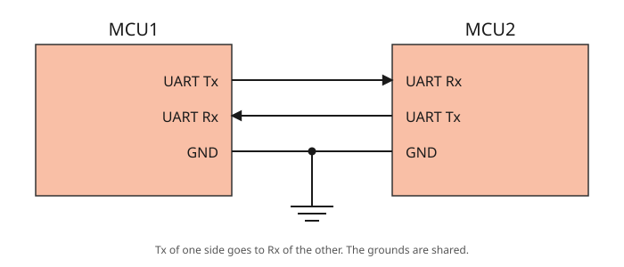
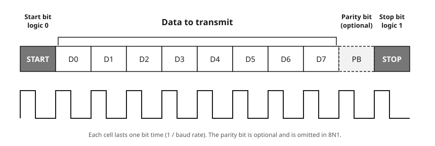
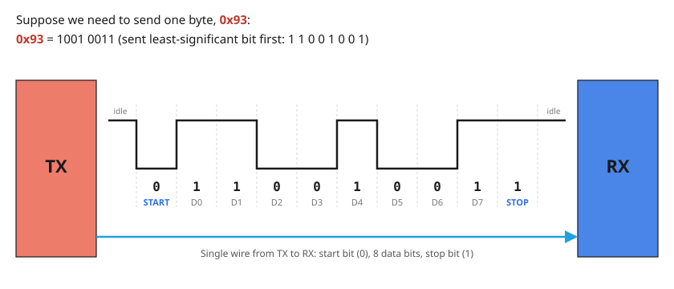

# 6.1 — UART: "Hello World" over a CH340G, stopped and resumed from the keyboard

**Board:** Nucleo-F446RE (STM32F446RETx)
**IDE:** STM32CubeIDE (GCC / make)

## Learning goal

This project teaches **how to send and receive data over UART** between the board and a PC through a CH340G USB-to-serial module.

After this project you can:
- explain a UART frame (start bit, data bits, stop bit) and why both ends need the same baud rate
- wire TX, RX and GND correctly between the Nucleo and a CH340G module
- receive bytes with an interrupt so the main loop is never blocked
- pass an event from an interrupt to the main loop with a `volatile` flag

## Overview

The board introduces itself on the serial port, then counts once per second:

```
Hello World, I am counting to 100....
1....
2....
3....
```

While counting, it is also **listening**: type `s` in the terminal and the count stops, type `r` and it continues where it left off. Sending is the easy half; receiving *without* freezing the loop that is already running is what needs interrupts.

## Theory

### How UART works

UART is **asynchronous**: there is no clock wire. Each side runs its own timer and both must be set to the same baud rate in advance. Here that is `115200` baud, 8 data bits, no parity, 1 stop bit (`8N1`). If the two sides disagree by more than roughly 2–3%, the receiver samples at the wrong instants and you get garbage characters, not an error.

### Two devices, three wires



Every UART device has a **Tx** pin (where it *talks*) and an **Rx** pin (where it *listens*). Two devices are connected by crossing them over:

- **Tx → Rx.** What one side transmits, the other receives. Tx to Tx would put two talkers on one wire and leave nobody listening.
- **Rx ← Tx.** The return path is a *second* wire, so both sides can talk at the same time (**full duplex**). This project does exactly that: it counts out while it listens for `s` and `r`.
- **GND — GND.** A logic level is a voltage *relative to something*; the shared ground is that something.

There is no clock wire and no "chip select" wire, which is why the link needs so few pins, and why UART connects exactly **two** devices. Here the Nucleo is one MCU (`PA9` = Tx, `PA10` = Rx) and the CH340G module is the other; the module talks to the PC over USB.

### The frame: start, data, stop



Each byte is wrapped in a **frame** so the receiver can tell where it begins and ends without a clock:

| Field | Level | Purpose |
|---|---|---|
| **Idle** | HIGH | The resting state of the line between frames |
| **Start bit** | LOW (logic 0) | The falling edge announces "a byte begins now" and starts the receiver's timer |
| **D0 … D7** | data | The eight bits of the byte, **least-significant bit first** |
| **Parity bit** (PB) | even / odd | *Optional.* One extra bit that makes the number of 1s even (or odd), so a single flipped bit can be detected. Not used here |
| **Stop bit** | HIGH (logic 1) | Returns the line to idle and guarantees the next start bit is a fresh falling edge |

**8N1** (8 data bits, No parity, 1 stop bit) is 1 + 8 + 1 = **10 bits on the wire per byte**, so at most 80% of the line speed carries data.

The **baud rate** is bits per second and fixes how long each cell lasts. At 115200 baud one bit lasts 1 / 115200 ≈ 8.7µs, so a frame takes about 87µs and the link moves roughly 11,500 bytes per second. With no clock wire, the receiver times every bit with its own timer, started by the falling edge of the start bit and aimed at the *middle* of each bit (the STM32 takes three samples around the middle and votes). That is why both sides must use the same baud rate.

### Worked example: sending 0x93



1. Write the byte in binary: `0x93` = `1001 0011`.
2. Reverse the order, because the **least-significant bit goes first**: `1 1 0 0 1 0 0 1`.
3. Put the start bit in front and the stop bit behind:

```
idle   start   D0 D1 D2 D3 D4 D5 D6 D7   stop   idle
 1       0      1  1  0  0  1  0  0  1     1      1
```

The receiver reverses the process: it waits for the line to fall, samples the eight bits in turn, stacks them with the first in the lowest position, checks that the stop bit is HIGH, and ends up with `0x93`. A waveform on an oscilloscope reads left to right as the binary number **backwards**.

### What the receiver does, and when the CPU finds out


While the 10 bits are on the wire, the CPU is **not involved**: the USART1 peripheral shifts them in by itself. Only when the stop bit ends does the finished byte land in the data register `DR` and the hardware raise the `RXNE` flag. That single instant (about 87µs after the first bit) is what everything below hangs off.

### Why reception must be interrupt-driven


`HAL_UART_Receive()` **blocks**: the CPU waits inside the function, checking `RXNE` over and over, until a byte arrives or the timeout expires. A user may not press a key for minutes, so the counter would freeze for minutes: you could count or listen, never both.

`HAL_UART_Receive_IT()` arms the peripheral and returns immediately. The loop keeps running, and only when a byte actually arrives is the CPU pulled aside for a few microseconds. Transmission stays blocking, which is fine: sending a short string at 115200 baud takes about a millisecond, at a moment the program chose.

### From the wire to your callback

`HAL_UART_RxCpltCallback()` is never called by this project's code, yet it runs:


Two details fail **silently** when wrong:

- **The callback is a weak symbol.** HAL ships an empty `__weak` version; your definition with the same name replaces it at link time. A one-letter typo gives no error, and HAL keeps calling the empty one.
- **Three switches must all be on:** the `RXNEIE` bit in `USART1->CR1` (set by `HAL_UART_Receive_IT()`), NVIC line 37 (enabled only if the CubeMX **NVIC** box is ticked), and `USART1_IRQHandler()` in `stm32f4xx_it.c` (generated from the same tick).

## Hardware & wiring

The Nucleo already has a USB-to-serial bridge in its ST-Link chip (`USART2`, `PA2`/`PA3`). This project deliberately uses `USART1` on `PA9`/`PA10` with an external module instead, so you wire TX and RX yourself, the same situation as with a GPS module, an ESP8266 or an HC-06 Bluetooth module.

**CH340G module:** converts USB to UART logic levels and appears in Windows as a virtual COM port.

| | |
|---|---|
| **Chip** | WCH CH340G |
| **Logic level** | 3.3V or 5V via an onboard jumper: **set it to 3V3** |
| **Driver** | Usually automatic on Windows 11; otherwise install `CH341SER` from WCH |
| **Appears as** | `USB-SERIAL CH340 (COMx)` under *Ports (COM & LPT)* in Device Manager |

> **Check the logic level with a multimeter.** On some cheap modules the jumper only changes the `VCC` output while the chip still runs at 5V. With only USB connected, measure `TXD` against `GND`: an idle UART line is HIGH, so that voltage *is* the logic level. If it reads ~5V, feed `PA10` through a 1kΩ / 2kΩ divider.


| CH340G | Nucleo-F446RE | Location |
|---|---|---|
| `TXD` | **PA10** (`USART1_RX`) | header `CN9`, pin `D2` |
| `RXD` | **PA9** (`USART1_TX`) | header `CN5`, pin `D8` |
| `GND` | `GND` | power header `CN6` |
| `3V3` / `5V` | **not connected** | — |

Three wires and two USB cables, one per board. TX goes to RX. GND is mandatory because a logic level needs a shared reference. `VCC` stays unconnected: both boards are already powered over USB and their regulators must not be tied together.

**Terminal:** open the CH340G's COM port at `115200`, 8 data bits, no parity, 1 stop bit, no flow control (in Hercules: Baud `115200`, Data size `8`, Parity `none`, Handshake `OFF`).

## CubeMX setup

1. `File → New → STM32 Project` → Board Selector → **NUCLEO-F446RE** → Next → finish the wizard. The Board Selector sets up the accurate 8MHz `HSE` clock from the ST-Link, which matters because UART tolerates only about ±2.5% total clock error (the internal `HSI` can drift ±1% to ±4%).
2. **Connectivity → USART1** → **Mode** = `Asynchronous`.
3. **Parameter Settings**: Baud Rate `115200`, Word Length `8 Bits`, Parity `None`, Stop Bits `1`, Data Direction `Receive and Transmit`, Over Sampling `16 Samples`.
4. **Pinout view**: confirm `PA9` = `USART1_TX` and `PA10` = `USART1_RX` (move them back if CubeMX picked `PB6`/`PB7`).
5. **System Core → NVIC**: tick **USART1 global interrupt**. Without it the callback is never reached.
6. **Project Manager → Project** → Toolchain / IDE = `STM32CubeIDE`.
7. **Project Manager → Code Generator** → **`Copy only the necessary library files`**.
8. **GENERATE CODE**. Check that `stm32f4xx_hal_msp.c` now contains `HAL_NVIC_EnableIRQ(USART1_IRQn)` and `stm32f4xx_it.c` contains `USART1_IRQHandler()`.

## Code

Everything is in `Core/Src/main.c`, inside the `USER CODE` markers (code outside them is erased when CubeMX regenerates).

**Globals and constants**

```c
/* USER CODE BEGIN Includes */
#include <stdio.h>
/* USER CODE END Includes */

/* USER CODE BEGIN PD */
#define COUNT_INTERVAL_MS 1000U
#define COUNT_MAX 100U
/* USER CODE END PD */

/* USER CODE BEGIN PV */
static uint8_t rx_byte;               // landing slot HAL writes the received byte into
volatile uint8_t running = 1;         // set by the interrupt, read by main()
/* USER CODE END PV */
```

`running` is `volatile` because the main loop never assigns it: without `volatile` the compiler may read it once and never again, and the interrupt would update memory nobody looks at. That works at `-O0` (Debug) and breaks at `-O2` (Release).

**Callbacks**

```c
/* USER CODE BEGIN 0 */
void HAL_UART_RxCpltCallback(UART_HandleTypeDef *huart)
{
  if (huart->Instance == USART1)
  {
    if (rx_byte == 's') running = 0;
    if (rx_byte == 'r') running = 1;
    HAL_UART_Receive_IT(&huart1, &rx_byte, 1);   // re-arm
  }
}

void HAL_UART_ErrorCallback(UART_HandleTypeDef *huart)
{
  if (huart->Instance == USART1)
  {
    __HAL_UART_CLEAR_OREFLAG(&huart1);
    HAL_UART_Receive_IT(&huart1, &rx_byte, 1);
  }
}
/* USER CODE END 0 */
```

- One character is a whole command, so no buffer and no string compare are needed.
- `huart->Instance == USART1`: the callback is shared by every UART on the chip.
- `HAL_UART_Receive_IT()` is a **one-shot**: it receives the requested bytes, fires the callback and disarms itself. Without the re-arm you receive exactly one character, ever.
- USART1 has one receive register and no queue. If a byte arrives before the previous one is read, the **overrun** flag `ORE` is raised and HAL *cancels the armed reception*. `HAL_UART_ErrorCallback()` clears the flag and re-arms; without it the UART goes permanently deaf while transmission still looks healthy.

**Setup and main loop**

```c
/* USER CODE BEGIN 2 */
char     buf[64];
int      n;
uint32_t count     = 1;
uint32_t last_tick = HAL_GetTick();

HAL_UART_Receive_IT(&huart1, &rx_byte, 1);   // initial arming
/* USER CODE END 2 */

/* USER CODE BEGIN 3 */
if (!running)
{
  last_tick = HAL_GetTick();
}
else if (HAL_GetTick() - last_tick >= COUNT_INTERVAL_MS)
{
  last_tick += COUNT_INTERVAL_MS;

  if (count == 1)
  {
    n = snprintf(buf, sizeof(buf),
                 "\r\nHello World, I am counting to %u....\r\n", COUNT_MAX);
    HAL_UART_Transmit(&huart1, (uint8_t *)buf, n, HAL_MAX_DELAY);
  }

  n = snprintf(buf, sizeof(buf), "%lu....\r\n", (unsigned long)count);
  HAL_UART_Transmit(&huart1, (uint8_t *)buf, n, HAL_MAX_DELAY);

  count = (count >= COUNT_MAX) ? 1 : count + 1;
}
/* USER CODE END 3 */
```

- **`snprintf` into `buf`**: `count` is a binary number (`42` is the byte `0x2A`), but the terminal needs the characters `'4'` `'2'`. `snprintf` converts and is bounded by `sizeof(buf)`; its return value is the length `HAL_UART_Transmit` needs. `%lu` with a cast matches `uint32_t` on this toolchain.
- **`\r\n`, not `\n`**: the carriage return moves the cursor back to column one, otherwise the output marches diagonally.
- **`HAL_GetTick() - last_tick >= INTERVAL`**: the unsigned subtraction stays correct when the 32-bit tick wraps (about every 49.7 days).
- **`last_tick += INTERVAL`, not `= HAL_GetTick()`**: each deadline stays on a fixed grid instead of drifting by the time the transmit took.
- **`if (!running) last_tick = HAL_GetTick();`**: while paused, `last_tick` would stand still and the difference would grow; on `r` the condition would fire many times in a row and dump a burst of numbers. Keeping `last_tick` current means there is no debt to repay. Nothing blocks, so `r` takes effect instantly.
- **`count + 1`, never `count++`**: `count++` evaluates to the old value, which the assignment writes straight back, so the count never moves (and it is undefined behaviour to modify `count` twice in one expression).

## Folder structure

```
6_1_UART_HELLO_WORLD/
├── Core/Src, Core/Inc                 - CubeMX-generated HAL init code + application code
├── Drivers/                           - STM32 HAL + CMSIS (generated, not hand-edited)
├── 6_UART_HELLO_WORLD.ioc             - CubeMX pin/clock configuration
├── README.md                          - this file
├── wiring_diagram.svg                 - CH340G to Nucleo wiring
├── uart_frame_diagram.svg             - one UART frame and where the interrupt comes from
├── polling_vs_interrupt_diagram.svg   - why reception cannot be blocking
├── interrupt_chain_diagram.svg        - RXNE flag → NVIC → vector table → callback
└── diagrams/                          - UART basics: uart_connection, uart_frame_format, uart_byte_0x93
```
