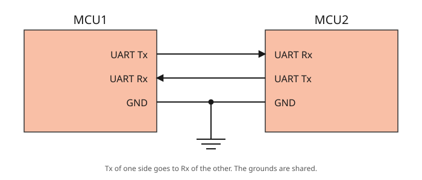
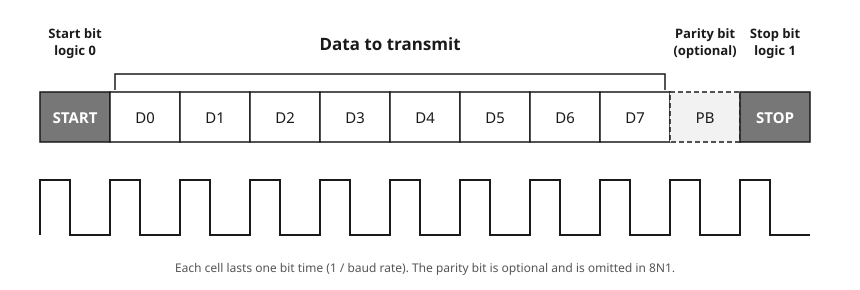
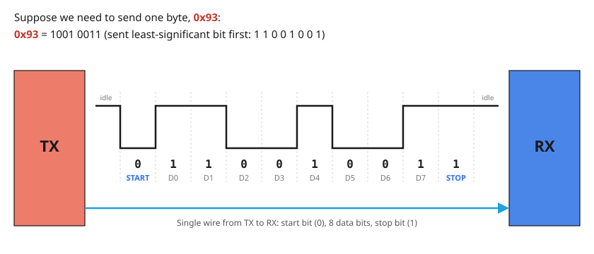

# 6.2 — UART: switching the on-board LED from the keyboard, with a small library

**Board:** Nucleo-F446RE (STM32F446RETx)
**IDE:** STM32CubeIDE (GCC / make)

## Learning goal

This project teaches **how to control hardware from a PC over UART**, and how to package the UART code as a small reusable library.

After this project you can:
- explain how a typed character reaches your code as a number (ASCII)
- hand a command from an interrupt to the main loop with a `volatile` flag and a one-byte mailbox
- split a module into a public header and a private source file
- handle unknown input with `switch` / `default` and reply to the sender

## Overview

Type a letter in the terminal and the LED obeys:

```
UART LED ready. Send 'a' = ON, 'b' = OFF
a   →  LED ON                       (LD2 lights up)
b   →  LED OFF                      (LD2 goes dark)
x   →  Please choose a to turn on LED or b to turn off LED
```

It builds on [6_1_UART_HELLO_WORLD](../6_1_UART_HELLO_WORLD) (same interrupt-driven receive), but all UART and LED code now lives in a two-file library, `uart_led.c/.h`, and `main.c` shrinks to a few one-line calls.

## Theory

### How UART works

UART is **asynchronous**: there is no clock wire. Each side runs its own timer and both must be set to the same baud rate in advance. Here that is `115200` baud, 8 data bits, no parity, 1 stop bit (`8N1`). If the two sides disagree by more than roughly 2–3%, the receiver samples at the wrong instants and you get garbage, or nothing at all. A terminal left at `9600` will not understand a board talking at `115200`.

### Two devices, three wires



Every UART device has a **Tx** pin (where it *talks*) and an **Rx** pin (where it *listens*). Two devices are connected by crossing them over:

- **Tx → Rx.** What one side transmits, the other receives. Tx to Tx would put two talkers on one wire and leave nobody listening.
- **Rx ← Tx.** The return path is a *second* wire, so both sides can talk at the same time (**full duplex**).
- **GND — GND.** A logic level is a voltage *relative to something*; the shared ground is that something.

There is no clock wire and no "chip select" wire, which is why the link needs so few pins, and why UART connects exactly **two** devices. Here the Nucleo is one MCU (`PA9` = Tx, `PA10` = Rx) and the CH340G module is the other; the module talks to the PC over USB.

### The frame: start, data, stop



Each byte is wrapped in a **frame** so the receiver can tell where it begins and ends without a clock:

| Field | Level | Purpose |
|---|---|---|
| **Idle** | HIGH | The resting state of the line between frames |
| **Start bit** | LOW (logic 0) | The falling edge announces "a byte begins now" and starts the receiver's timer |
| **D0 … D7** | data | The eight bits of the byte, **least-significant bit first** |
| **Parity bit** (PB) | even / odd | *Optional.* One extra bit that makes the number of 1s even (or odd), so a single flipped bit can be detected. Not used here |
| **Stop bit** | HIGH (logic 1) | Returns the line to idle and guarantees the next start bit is a fresh falling edge |

**8N1** is 1 + 8 + 1 = **10 bits on the wire per byte**, so at most 80% of the line speed carries data.

The **baud rate** is bits per second and fixes how long each cell lasts. At 115200 baud one bit lasts 1 / 115200 ≈ 8.7µs, so a frame takes about 87µs and the link moves roughly 11,500 bytes per second. With no clock wire, the receiver times every bit with its own timer, started by the falling edge of the start bit and aimed at the *middle* of each bit (the STM32 takes three samples around the middle and votes). That is why both sides must use the same baud rate.

### Worked example: sending 0x93



1. Write the byte in binary: `0x93` = `1001 0011`.
2. Reverse the order, because the **least-significant bit goes first**: `1 1 0 0 1 0 0 1`.
3. Put the start bit in front and the stop bit behind:

```
idle   start   D0 D1 D2 D3 D4 D5 D6 D7   stop   idle
 1       0      1  1  0  0  1  0  0  1     1      1
```

The receiver reverses the process: it waits for the line to fall, samples the eight bits in turn, stacks them with the first in the lowest position, checks that the stop bit is HIGH, and ends up with `0x93`. A waveform on an oscilloscope reads left to right as the binary number **backwards**.

### A keystroke is a number

The PC does not send the *letter* `a`. It sends the number **97**, and the terminal agrees to draw 97 as `a`. That agreement is the ASCII table:

| Key | Decimal | Hex | Binary |
|---|---|---|---|
| `a` | 97 | `0x61` | `0110 0001` |
| `b` | 98 | `0x62` | `0110 0010` |
| Enter | 13 + 10 | `0x0D 0x0A` | `\r` `\n` |

In C, `'a'` is just another way to write `97`. So `case 'a':` compares the received byte with the number 97, and `default:` catches every other value from 0 to 255.

### One keystroke on the wire


`0x61` is `0110 0001`, but it travels as `1 0 0 0 0 1 1 0` because the lowest bit goes first. A whole frame takes about **87µs**, and for that time the CPU is **not involved**: the USART1 peripheral shifts the bits in by itself. Only when the stop bit ends does the byte land in the data register `DR` and the hardware raise the `RXNE` flag. That instant is what everything below hangs off.

### From the flag to your function

`HAL_UART_RxCpltCallback()` is never called by this project's own code, yet it runs. The chain (RXNE → `USART1_IRQHandler` → HAL → callback) is drawn in [6.1's interrupt chain diagram](../6_1_UART_HELLO_WORLD/interrupt_chain_diagram.svg). Two details fail **silently** when wrong:

- **Three switches must all be on:** `RXNEIE` in `USART1->CR1` (set by `HAL_UART_Receive_IT()`), the NVIC line for USART1 (only if the CubeMX **NVIC** box is ticked), and `USART1_IRQHandler()` in `stm32f4xx_it.c` (generated from the same tick).
- **The callback is a weak symbol.** HAL ships an empty `__weak` `HAL_UART_RxCpltCallback`; your definition replaces it at link time, but a one-letter typo gives no error and HAL keeps calling the empty one.

### From keystroke to LED


The work is split across two places on purpose.

- **Interrupt side**, a few microseconds, only when a byte arrives: copy the byte into a mailbox (`rx_cmd`), raise a flag (`rx_ready = 1`), re-arm the receiver.
- **Main-loop side**: every pass of `while(1)` checks the flag. Almost always it is `0` and the function returns at once. When it is `1`, the loop takes the command, clears the flag, and does the slow part: drive the pin and send the reply.

The reply (`HAL_UART_Transmit`) blocks until every character is out: about 1ms for `LED ON`, about 4.6ms for the warning. Inside an interrupt that would hold off every other interrupt of the same or lower priority, SysTick among them, so an interrupt should be as short as a doorbell press: record that it happened and get out.

### Why a library

| File | Contains | Visible to `main.c`? |
|---|---|---|
| `uart_led.h` | The four function prototypes | Yes: the public contract |
| `uart_led.c` | `led_uart`, `rx_byte`, `rx_cmd`, `rx_ready`, `UART_LED_Send()` and the function bodies | Only the four public functions |
| `main.c` | `#include "uart_led.h"`, two HAL callbacks that forward to the library, three one-line calls | — |

`static` means "private to this `.c` file": `main.c` cannot touch `rx_ready` by accident, and the library can be rewritten as long as the four prototypes stay the same. The UART is passed in as an **argument** (`UART_LED_Init(&huart1)`), so moving to `USART2` is a one-argument change in `main.c`.

## Hardware & wiring

The LED is **LD2**, the green one on the board, wired to `PA5`. It lights when `PA5` is HIGH (`GPIO_PIN_SET`). No resistor or wire needed.

As in [6.1](../6_1_UART_HELLO_WORLD), the UART is `USART1` on `PA9`/`PA10` with an external **CH340G** module (jumper on **3V3**; it appears as `USB-SERIAL CH340 (COMx)` in Device Manager). The module details and the logic-level check are in 6.1.


| CH340G | Nucleo-F446RE | Location |
|---|---|---|
| `TXD` | **PA10** (`USART1_RX`) | header `CN9`, pin `D2` |
| `RXD` | **PA9** (`USART1_TX`) | header `CN5`, pin `D8` |
| `GND` | `GND` | power header `CN6` |
| `3V3` / `5V` | **not connected** | — |

Three wires and two USB cables, one per board. TX goes to RX; GND is mandatory because a logic level needs a shared reference; `VCC` stays unconnected because both boards are already powered over USB.

**Terminal:** open the CH340G's COM port at `115200`, 8 data bits, no parity, 1 stop bit, no flow control (in Hercules: Baud `115200`, Data size `8`, Parity `none`, Handshake `OFF`). Send the letter alone; no line terminator is needed.

## CubeMX setup

1. `File → New → STM32 Project` → **Board Selector** → **NUCLEO-F446RE** → Next. Project name `6_2_UART_Control_LED`, language `C`.
2. Answer **Yes** to *"Initialize all peripherals with their default Mode?"*. This sets `PA5` as `GPIO_Output` labelled **`LD2`** and selects the accurate 8MHz `HSE` clock from the ST-Link.
3. **Pinout view**: click `PA5` and confirm `GPIO_Output` with label `LD2` (add it with right-click → *Enter User Label* if missing). The label generates `LD2_Pin` and `LD2_GPIO_Port`, which the library uses.
4. **Connectivity → USART1** → **Mode** = `Asynchronous`; Baud Rate `115200`, Word Length `8 Bits`, Parity `None`, Stop Bits `1`, Data Direction `Receive and Transmit`, Over Sampling `16 Samples`.
5. Confirm `PA9` = `USART1_TX` and `PA10` = `USART1_RX` (move them back if CubeMX picked `PB6`/`PB7`).
6. **USART1 → NVIC Settings** (or **System Core → NVIC**): tick **USART1 global interrupt**. Without it the callback is never reached and the build gives no warning.
7. **Project Manager → Code Generator** → **`Copy only the necessary library files`**.
8. **GENERATE CODE** (`Ctrl+S`). Verify that `stm32f4xx_hal_msp.c` contains `HAL_NVIC_EnableIRQ(USART1_IRQn)` and `stm32f4xx_it.c` contains `USART1_IRQHandler()`.

## Code

Create `Core/Inc/uart_led.h` and `Core/Src/uart_led.c` (CubeIDE already has `Core/Inc` on the include path and builds everything in `Core/Src`). In `main.c`, write only between the `USER CODE BEGIN/END` markers; anything outside them is erased when CubeMX regenerates.

### `uart_led.h`

```c
#ifndef UART_LED_H
#define UART_LED_H

#include "main.h"

void UART_LED_Init(UART_HandleTypeDef *huart);
void UART_LED_Process(void);
void UART_LED_RxCallback(UART_HandleTypeDef *huart);
void UART_LED_ErrorCallback(UART_HandleTypeDef *huart);

#endif
```

`#ifndef … #endif` is an include guard (a second inclusion is skipped). `main.h` brings in HAL and the generated `LD2_*` names.

### `uart_led.c`

Write the file top to bottom: each function must be defined above the code that calls it.

**State and helper**

```c
#include "uart_led.h"
#include <string.h>

static UART_HandleTypeDef *led_uart;   // the UART given to Init
static uint8_t rx_byte;                // landing slot HAL writes the received byte into
static volatile uint8_t rx_cmd;        // mailbox: the command, kept for the main loop
static volatile uint8_t rx_ready = 0;  // flag: 1 = a new command is waiting

static void UART_LED_Send(const char *msg)
{
  HAL_UART_Transmit(led_uart, (uint8_t *)msg, strlen(msg), HAL_MAX_DELAY);
}
```

`rx_cmd` and `rx_ready` are written by the interrupt and read by `while(1)`, so they are `volatile`: otherwise the compiler may read them once and never again (works at `-O0`, breaks at `-O2`). `rx_byte` is only touched by HAL and the callback, so it is not.

**Init**

```c
void UART_LED_Init(UART_HandleTypeDef *huart)
{
  led_uart = huart;   // the parameter dies when Init returns; the static variable lives on

  HAL_GPIO_WritePin(LD2_GPIO_Port, LD2_Pin, GPIO_PIN_RESET);
  UART_LED_Send("\r\nUART LED ready. Send 'a' = ON, 'b' = OFF\r\n");

  HAL_UART_Receive_IT(led_uart, &rx_byte, 1);
}
```

The greeting proves the TX wire, baud rate and COM port are right. `HAL_UART_Receive_IT()` receives nothing itself: it enables the interrupt and returns.

**Interrupt side**

```c
void UART_LED_RxCallback(UART_HandleTypeDef *huart)
{
  if (huart != led_uart) return;     // HAL calls this for every UART on the chip

  rx_cmd   = rx_byte;                // copy out before the next byte overwrites rx_byte
  rx_ready = 1;

  HAL_UART_Receive_IT(led_uart, &rx_byte, 1);   // one-shot: re-arm or the board goes deaf
}

void UART_LED_ErrorCallback(UART_HandleTypeDef *huart)
{
  if (huart != led_uart) return;

  __HAL_UART_CLEAR_OREFLAG(led_uart);
  HAL_UART_Receive_IT(led_uart, &rx_byte, 1);
}
```

If a byte arrives before the previous one is read (USART1 has no queue), the **overrun** flag is raised and HAL cancels the armed reception. The error callback clears it and re-arms; without it the UART goes permanently deaf.

**Main-loop side**

```c
void UART_LED_Process(void)
{
  if (!rx_ready) return;        // called millions of times a second: exit fast when idle

  uint8_t cmd = rx_cmd;         // local copy: stays valid even if a new byte arrives
  rx_ready = 0;

  switch (cmd)
  {
    case 'a':
      HAL_GPIO_WritePin(LD2_GPIO_Port, LD2_Pin, GPIO_PIN_SET);
      UART_LED_Send("LED ON\r\n");
      break;

    case 'b':
      HAL_GPIO_WritePin(LD2_GPIO_Port, LD2_Pin, GPIO_PIN_RESET);
      UART_LED_Send("LED OFF\r\n");
      break;

    case '\r':                  // Enter: PuTTY and Tera Term append it to every send
    case '\n':
      break;

    default:
      UART_LED_Send("Please choose a to turn on LED or b to turn off LED\r\n");
      break;
  }
}
```

Copy the command **before** clearing the flag. Ignoring `'\r'` and `'\n'` stops terminals that append Enter from adding two extra warnings after every `a`.

### `main.c`

```c
/* USER CODE BEGIN Includes */
#include "uart_led.h"
/* USER CODE END Includes */

/* USER CODE BEGIN 0 */
void HAL_UART_RxCpltCallback(UART_HandleTypeDef *huart)
{
  UART_LED_RxCallback(huart);
}

void HAL_UART_ErrorCallback(UART_HandleTypeDef *huart)
{
  UART_LED_ErrorCallback(huart);
}
/* USER CODE END 0 */

/* USER CODE BEGIN 2 */
UART_LED_Init(&huart1);       // after MX_GPIO_Init() and MX_USART1_UART_Init()
/* USER CODE END 2 */

/* USER CODE BEGIN 3 */
UART_LED_Process();           // inside while(1)
/* USER CODE END 3 */
```

The HAL callbacks live in `main.c` because a weak symbol may be overridden **once** per program: if the library defined it, a second UART module (GPS, Bluetooth) would fail to link. One definition in `main.c` forwarding to each library lets every module have its turn. `UART_LED_Init()` goes in `USER CODE 2` because the GPIO and USART1 are initialised by then.

## Folder structure

```
6_2_UART_Control_LED/
├── Core/Inc/uart_led.h                - library: public prototypes
├── Core/Src/uart_led.c                - library: state, receive, dispatch, replies
├── Core/Src, Core/Inc                 - CubeMX-generated HAL init code + main.c
├── Drivers/                           - STM32 HAL + CMSIS (generated, not hand-edited)
├── 6_2_UART_Control_LED.ioc           - CubeMX pin/clock configuration
├── README.md                          - this file
├── wiring_diagram.svg                 - CH340G to Nucleo wiring
├── uart_frame_diagram.svg             - the letter 'a' as one UART frame
├── command_flow_diagram.svg           - keystroke → interrupt → flag → main loop → LED
└── diagrams/                          - UART basics: uart_connection, uart_frame_format, uart_byte_0x93 (.svg + .png)
```
