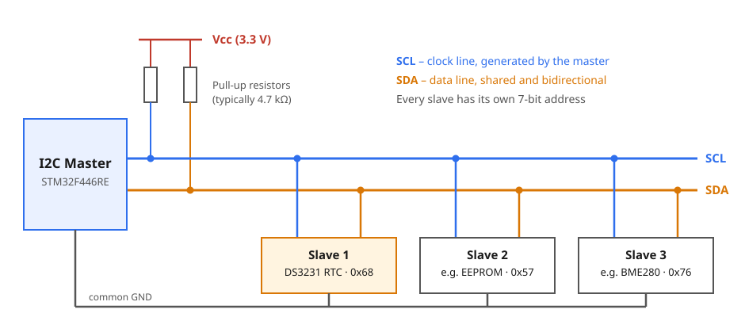
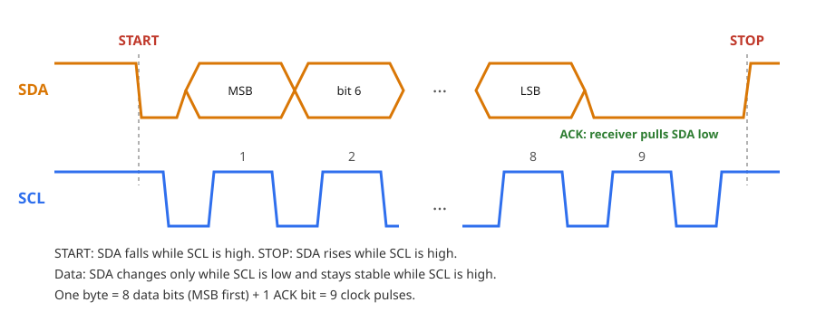
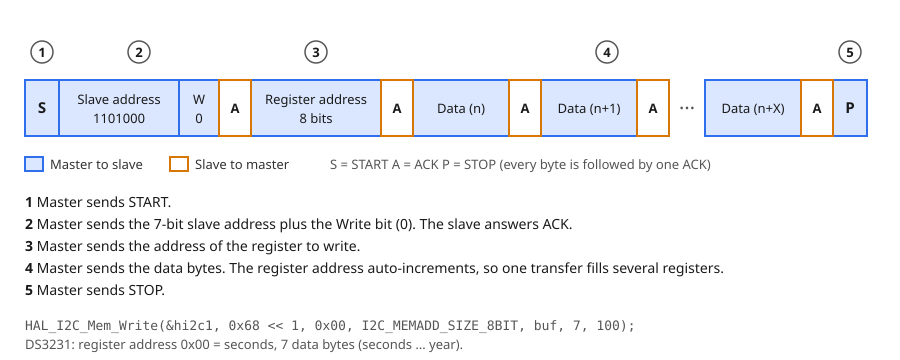
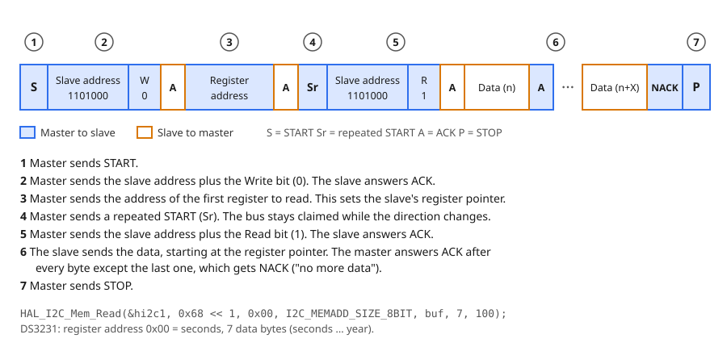
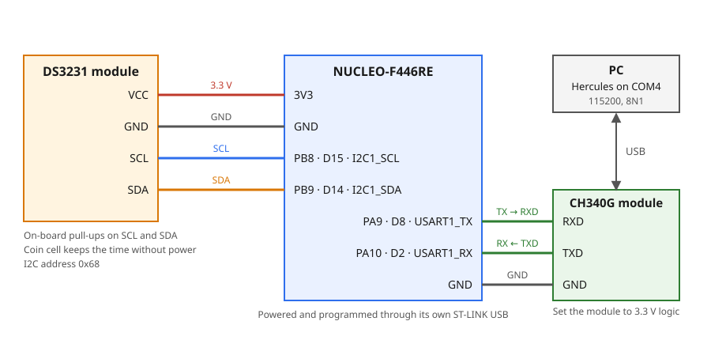

# 7.1 — I2C: DS3231 Real-Time Clock over UART

**Board:** Nucleo-F446RE (STM32F446RETx)
**IDE:** STM32CubeIDE (GCC / make)

## Learning goal

This project teaches **how the I2C bus works and how to read and write the registers of an I2C device**, using a DS3231 real-time clock (RTC). It also shows how to keep each device driver in its own library and join the libraries in `main.c`.

After this project you can:
- explain how I2C shares two wires between several devices with addresses and ACK bits
- read and write a device's registers with `HAL_I2C_Mem_Read` and `HAL_I2C_Mem_Write`, decoding BCD values on the way
- wire a DS3231 module and a CH340G module to the Nucleo
- build a project from two independent libraries (`ds3231`, `ch340g`) glued together in `main.c`

## Overview

The board reads the time from the DS3231 and prints it to the PC once per second as `dd/mm/yyyy hh:mm:ss`. The PC can set the time by sending a text command:

```
02/11/2026 18:52:12
02/11/2026 18:52:13
SET 03/11/2026 09:15:00        <- typed in the terminal
Time set
03/11/2026 09:15:00
```

## Theory

### The DS3231 module

The **DS3231** is a real-time clock chip with a built-in temperature-compensated crystal, accurate to about ±2 ppm (roughly one minute per year) between 0 and 40 °C. It counts seconds, minutes, hours, weekday, date, month and year, with leap years handled until 2100. It runs from 2.3 to 5.5 V and talks I2C at up to 400 kHz. Its address is fixed at `0x68`.

A **coin cell** on the module powers the clock when the board is off, so the time survives power loss. Common breakout modules also carry the pull-up resistors for SCL and SDA and an AT24C32 EEPROM (address `0x57`). Their pins are `32K`, `SQW`, `SCL`, `SDA`, `VCC` and `GND`; this project uses the last four.

The chip is controlled through registers. The first seven hold the time:

| Address | Content | Range |
|---|---|---|
| `0x00` | seconds | 00–59 |
| `0x01` | minutes | 00–59 |
| `0x02` | hours | 00–23 (24-hour mode) |
| `0x03` | day of week | 1–7 |
| `0x04` | date | 01–31 |
| `0x05` | month | 01–12 |
| `0x06` | year | 00–99 |

The remaining registers (`0x07`–`0x12`) hold alarms, control and status bits and the temperature; this project does not use them.

The chip keeps an internal **register pointer**. Every transfer first sets the pointer, and after each byte the pointer moves to the next register. One transfer can therefore read or write all seven time registers. Reading them in one transfer also gives a consistent snapshot: the chip copies the time into a buffer when the transfer starts, so you never mix `12:59:59` with `13:00:00`.

### BCD

The DS3231 stores each value in **BCD** (binary-coded decimal): every decimal digit takes 4 bits. The value 45 is stored as `0100 0101` = `0x45`, not as `0x2D`.

```
BCD -> decimal: (value >> 4) * 10 + (value & 0x0F)
decimal -> BCD: ((value / 10) << 4) | (value % 10)
```

Some registers also hold flag bits next to the value, which must be masked off when reading:

| Register | Flag | Mask to keep the value |
|---|---|---|
| hours | bit 6 selects 12/24-hour mode | `& 0x3F` |
| month | bit 7 is the century flag | `& 0x1F` |
| seconds, minutes | bit 7 is always 0 | `& 0x7F` |

### How I2C works

**I2C** (Inter-Integrated Circuit) connects many devices with only two wires. One device is the **master** (the STM32); it starts every transfer and generates the clock. The others are **slaves** (the DS3231). Every slave has a 7-bit **address**, and the master picks which slave answers by sending that address first.



- **SCL** is the clock line, driven by the master.
- **SDA** is the data line, shared in both directions.
- Both lines are **open-drain**: a device can only pull a line low, and a **pull-up resistor** brings it back high when nobody pulls. This lets many devices share a line without short circuits, and it is why the resistors are required.

Every byte is sent as 8 bits, most significant bit first, followed by a 9th clock in which the receiver answers with an **ACK** (SDA pulled low) or a **NACK** (SDA left high).



- **START**: SDA falls while SCL is high. **STOP**: SDA rises while SCL is high. These are the only times SDA may change while SCL is high.
- Data bits change while SCL is low and are read while SCL is high.

At 100 kHz one byte (9 clocks) takes about 90 µs, so the 10 bytes of a time read take about 1 ms.

**Writing registers.** The first byte after START is the slave address plus a direction bit: `0` for write. For the DS3231, `1101000` (`0x68`) plus `0` is `0xD0` on the wire.



**Reading registers.** The master cannot say "read register 3" in one step, so it first writes the register address to set the slave's pointer, then sends a **repeated START (Sr)** and addresses the slave again with the read bit `1` (`0xD1`). The slave now sends data from the pointer onwards. The master ACKs every byte except the last, whose NACK tells the slave to stop.



HAL builds both transactions for you:

| HAL function | What goes on the bus |
|---|---|
| `HAL_I2C_IsDeviceReady` | START, address, wait for ACK, STOP (checks the device is present) |
| `HAL_I2C_Mem_Write` | the write transaction above |
| `HAL_I2C_Mem_Read` | the read transaction above, including the repeated START |

HAL expects the address in 8-bit form, the 7-bit address shifted left by one (`0x68 << 1`). It fills in the R/W bit itself.

### UART in this project

The UART frame, baud rate and TX/RX crossing are explained in [6_1_UART_HELLO_WORLD](../6_1_UART_HELLO_WORLD), and the interrupt-driven receive pattern in [6_2_UART_Control_LED](../6_2_UART_Control_LED). Here USART1 runs at 115200, 8N1 again. Two things are new: sending formatted text with `vsnprintf`, and receiving a whole command line, which is considered complete when a CR/LF arrives or the line has been quiet for 50 ms.

## Hardware & wiring

| Signal | Nucleo pin | Notes |
|---|---|---|
| DS3231 `VCC` | 3V3 | 3.3 V keeps SDA/SCL at 3.3 V logic |
| DS3231 `GND` | GND | |
| DS3231 `SCL` | PB8 (D15) | `I2C1_SCL` |
| DS3231 `SDA` | PB9 (D14) | `I2C1_SDA` |
| CH340G `RXD` | PA9 (D8) | `USART1_TX` |
| CH340G `TXD` | PA10 (D2) | `USART1_RX` |
| CH340G `GND` | GND | Shared ground |



- TX goes to RXD and RX to TXD (crossed). Set the CH340G module to **3.3 V** logic and leave its `VCC` unconnected; USB powers it. It appears as its own COM port (the ST-LINK has a separate one that is not used here). Terminal: `115200, 8N1, no flow control`.
- Some DS3231 modules charge the coin cell through a resistor. Use a rechargeable LIR2032, or a module without the charger, when the cell is not rechargeable.

## CubeMX setup

1. `File → New → STM32 Project` → Board Selector → **NUCLEO-F446RE** → Next → name it `7_1_I2C` → finish the wizard.
2. **Connectivity → I2C1**: Mode = `I2C`. Check the pinout shows **PB8 = I2C1_SCL** and **PB9 = I2C1_SDA** (re-pick them if CubeMX chose PB6/PB7). **I2C Speed Mode** = `Standard Mode`, **Clock Speed** = `100000`.
3. **Connectivity → USART1**: Mode = `Asynchronous`. Pinout **PA9 = USART1_TX**, **PA10 = USART1_RX**. **Baud Rate** = `115200`, **Word Length** = `8 Bits`, **Parity** = `None`, **Stop Bits** = `1`.
4. **USART1 → NVIC Settings** → tick **USART1 global interrupt**. Without it the board never receives a byte and nothing reports an error.
5. **Project Manager → Project** → Toolchain / IDE = `STM32CubeIDE`.
6. **Project Manager → Code Generator** → **`Copy only the necessary library files`**.
7. **GENERATE CODE**.

## Code

`ds3231` knows only I2C and `ch340g` knows only UART; `main.c` is the only place that knows both. Create the four library files in `Core/Inc` and `Core/Src` (CubeIDE already searches both). Code outside the `USER CODE` markers is lost when CubeMX regenerates.

### `ds3231` library

**`ds3231.h`**

```c
#ifndef DS3231_H
#define DS3231_H

#include "main.h"   // HAL types

typedef struct
{
  uint8_t second;   // 0..59
  uint8_t minute;   // 0..59
  uint8_t hour;     // 0..23
  uint8_t day;      // day of week, 1 = Sunday .. 7 = Saturday
  uint8_t date;     // day of month, 1..31
  uint8_t month;    // 1..12
  uint8_t year;     // 0..99 (2000 + year)
} DS3231_Time;

HAL_StatusTypeDef DS3231_Init(I2C_HandleTypeDef *hi2c);
HAL_StatusTypeDef DS3231_SetTime(const DS3231_Time *time);
HAL_StatusTypeDef DS3231_GetTime(DS3231_Time *time);
uint8_t           DS3231_DayOfWeek(uint8_t date, uint8_t month, uint16_t year);

#endif
```

The functions return `HAL_StatusTypeDef` so `main.c` can tell when the bus fails (wire loose, module unpowered).

**`ds3231.c`**

```c
#include "ds3231.h"

#define DS3231_ADDR      (0x68 << 1)   // HAL wants the 7-bit address shifted left by 1
#define DS3231_REG_TIME  0x00          // first time register (seconds)
#define DS3231_TIMEOUT   100U          // ms

static I2C_HandleTypeDef *ds3231_i2c;  // set by DS3231_Init, used by every function

static uint8_t dec_to_bcd(uint8_t value)
{
  return (uint8_t)(((value / 10) << 4) | (value % 10));
}

static uint8_t bcd_to_dec(uint8_t value)
{
  return (uint8_t)(((value >> 4) * 10) + (value & 0x0F));
}

uint8_t DS3231_DayOfWeek(uint8_t date, uint8_t month, uint16_t year)   // Sakamoto's algorithm
{
  static const uint8_t offset[] = {0, 3, 2, 5, 0, 3, 5, 1, 4, 6, 2, 4};

  if (month < 3)
  {
    year -= 1;   // Jan and Feb count as part of the previous year
  }

  uint8_t w = (uint8_t)((year + year / 4 - year / 100 + year / 400
                         + offset[month - 1] + date) % 7);   // 0 = Sunday
  return (uint8_t)(w + 1);                                      // DS3231 stores 1..7
}

HAL_StatusTypeDef DS3231_Init(I2C_HandleTypeDef *hi2c)
{
  ds3231_i2c = hi2c;   // keep it: the parameter disappears when the function returns

  // Is a device answering at this address? (3 tries, 10 ms each)
  return HAL_I2C_IsDeviceReady(ds3231_i2c, DS3231_ADDR, 3, 10);
}

HAL_StatusTypeDef DS3231_SetTime(const DS3231_Time *time)
{
  uint8_t buf[7];

  buf[0] = dec_to_bcd(time->second);
  buf[1] = dec_to_bcd(time->minute);
  buf[2] = dec_to_bcd(time->hour);     // bit 6 = 0 keeps 24-hour mode
  buf[3] = dec_to_bcd(time->day);
  buf[4] = dec_to_bcd(time->date);
  buf[5] = dec_to_bcd(time->month);
  buf[6] = dec_to_bcd(time->year);

  // write transaction: address 0x68, register 0x00, then 7 bytes
  return HAL_I2C_Mem_Write(ds3231_i2c, DS3231_ADDR, DS3231_REG_TIME,
                           I2C_MEMADD_SIZE_8BIT, buf, 7, DS3231_TIMEOUT);
}

HAL_StatusTypeDef DS3231_GetTime(DS3231_Time *time)
{
  uint8_t buf[7];

  // read transaction: set pointer to 0x00, repeated START, read 7 bytes
  HAL_StatusTypeDef status = HAL_I2C_Mem_Read(ds3231_i2c, DS3231_ADDR, DS3231_REG_TIME,
                                              I2C_MEMADD_SIZE_8BIT, buf, 7, DS3231_TIMEOUT);
  if (status != HAL_OK)
  {
    return status;   // leave *time untouched on failure
  }

  time->second = bcd_to_dec(buf[0] & 0x7F);
  time->minute = bcd_to_dec(buf[1] & 0x7F);
  time->hour   = bcd_to_dec(buf[2] & 0x3F);   // mask the 12/24-hour flag bits
  time->day    = bcd_to_dec(buf[3] & 0x07);
  time->date   = bcd_to_dec(buf[4] & 0x3F);
  time->month  = bcd_to_dec(buf[5] & 0x1F);   // bit 7 is the century flag
  time->year   = bcd_to_dec(buf[6]);

  return HAL_OK;
}
```

The `static` handle and the two BCD helpers are private to the file. The weekday is not typed by the user; `DS3231_DayOfWeek` computes it from the date.

### `ch340g` library

The CH340G is only a USB-to-UART chip, so this library simply wraps `USART1`.

**`ch340g.h`**

```c
#ifndef CH340G_H
#define CH340G_H

#include "main.h"   // HAL types

#define CH340G_RX_LINE_SIZE  40U   // longest command accepted, including the terminator

void              CH340G_Init(UART_HandleTypeDef *huart);
HAL_StatusTypeDef CH340G_Send(const char *str);
HAL_StatusTypeDef CH340G_Printf(const char *fmt, ...);

uint8_t CH340G_ReadLine(char *line, uint16_t size);       // 1 = a full line was copied into line
void    CH340G_RxCallback(UART_HandleTypeDef *huart);     // forward HAL_UART_RxCpltCallback here
void    CH340G_ErrorCallback(UART_HandleTypeDef *huart);  // forward HAL_UART_ErrorCallback here

#endif
```

**`ch340g.c`**

```c
#include "ch340g.h"
#include <stdarg.h>   // va_list, va_start, va_end
#include <stdio.h>    // vsnprintf
#include <string.h>   // strlen, strncpy

#define CH340G_TX_BUF_SIZE  64U
#define CH340G_TIMEOUT      100U   // ms
#define CH340G_RX_IDLE_MS   50U    // quiet time that marks the end of a command

static UART_HandleTypeDef *ch340g_uart;       // set by CH340G_Init

static uint8_t rx_byte;                       // the one byte HAL receives into
static char rx_line[CH340G_RX_LINE_SIZE];     // line being assembled
static uint16_t rx_len;                       // characters collected so far
static volatile uint8_t line_ready;           // ISR sets it, main loop clears it
static volatile uint32_t rx_tick;             // time of the last received character

void CH340G_Init(UART_HandleTypeDef *huart)
{
  ch340g_uart = huart;
  HAL_UART_Receive_IT(ch340g_uart, &rx_byte, 1);   // arm reception of ONE byte
}

HAL_StatusTypeDef CH340G_Send(const char *str)
{
  return HAL_UART_Transmit(ch340g_uart, (uint8_t *)str,
                           (uint16_t)strlen(str), CH340G_TIMEOUT);
}

HAL_StatusTypeDef CH340G_Printf(const char *fmt, ...)
{
  char buf[CH340G_TX_BUF_SIZE];

  va_list args;
  va_start(args, fmt);
  int n = vsnprintf(buf, sizeof(buf), fmt, args);   // never writes past the buffer
  va_end(args);

  if (n < 0)
  {
    return HAL_ERROR;
  }
  if (n >= (int)sizeof(buf))
  {
    n = (int)sizeof(buf) - 1;   // output was cut to fit: send only what is in buf
  }

  return HAL_UART_Transmit(ch340g_uart, (uint8_t *)buf, (uint16_t)n, CH340G_TIMEOUT);
}

void CH340G_RxCallback(UART_HandleTypeDef *huart)
{
  if (huart != ch340g_uart)
  {
    return;   // not our UART
  }

  if (!line_ready)   // while a line waits for the main loop, drop new bytes
  {
    if (rx_byte == '\r' || rx_byte == '\n')
    {
      if (rx_len > 0)            // ignore empty lines (CR followed by LF)
      {
        rx_line[rx_len] = '\0';
        line_ready = 1;
      }
    }
    else if (rx_len < CH340G_RX_LINE_SIZE - 1)
    {
      rx_line[rx_len++] = (char)rx_byte;
      rx_tick = HAL_GetTick();   // remember when the last character arrived
    }
  }

  HAL_UART_Receive_IT(ch340g_uart, &rx_byte, 1);   // re-arm: HAL receives one byte per call
}

void CH340G_ErrorCallback(UART_HandleTypeDef *huart)
{
  if (huart != ch340g_uart)
  {
    return;
  }
  __HAL_UART_CLEAR_OREFLAG(huart);                 // overrun: a byte arrived before the last was read
  HAL_UART_Receive_IT(ch340g_uart, &rx_byte, 1);   // overrun stops reception, so re-arm
}

uint8_t CH340G_ReadLine(char *line, uint16_t size)
{
  __disable_irq();   // keep the ISR from adding a character while we check
  if (!line_ready && rx_len > 0 && (HAL_GetTick() - rx_tick) >= CH340G_RX_IDLE_MS)
  {
    rx_line[rx_len] = '\0';   // no CR/LF came, but the line went quiet: it is complete
    line_ready = 1;
  }
  __enable_irq();

  if (!line_ready)
  {
    return 0;
  }

  strncpy(line, rx_line, size - 1);
  line[size - 1] = '\0';

  rx_len = 0;        // reset first, then release the buffer to the ISR
  line_ready = 0;
  return 1;
}
```

- `HAL_UART_Receive_IT` receives **one** byte and stops, so the callback must call it again (re-arm) or the next byte is lost.
- `line_ready` is `volatile` because the interrupt changes it where the main loop cannot see the write; without `volatile` the compiler may keep an old value and the loop would never notice a new line.
- The terminal may send CR, LF, both, or nothing (Hercules sends the text only). Accepting all of them, plus the 50 ms quiet time, makes any terminal work.

### `main.c`

```c
/* USER CODE BEGIN Includes */
#include <stdio.h>      // sscanf
#include "ds3231.h"
#include "ch340g.h"
/* USER CODE END Includes */

/* USER CODE BEGIN PV */
DS3231_Time now;
uint8_t last_second = 0xFF;          // impossible value, so the next reading always prints
char line[CH340G_RX_LINE_SIZE];      // command received from the PC
/* USER CODE END PV */

/* USER CODE BEGIN 0 */
static void handle_command(const char *cmd)
{
  int d, mo, y, h, mi, s;

  int valid = (sscanf(cmd, "SET %d/%d/%d %d:%d:%d", &d, &mo, &y, &h, &mi, &s) == 6)
           && d  >= 1    && d  <= 31
           && mo >= 1    && mo <= 12
           && y  >= 2000 && y  <= 2099
           && h  >= 0    && h  <= 23
           && mi >= 0    && mi <= 59
           && s  >= 0    && s  <= 59;

  if (!valid)
  {
    CH340G_Send("Error. Use: SET dd/mm/yyyy hh:mm:ss\r\n");
    return;
  }

  DS3231_Time t = { .second = (uint8_t)s,
                    .minute = (uint8_t)mi,
                    .hour   = (uint8_t)h,
                    .day    = DS3231_DayOfWeek((uint8_t)d, (uint8_t)mo, (uint16_t)y),
                    .date   = (uint8_t)d,
                    .month  = (uint8_t)mo,
                    .year   = (uint8_t)(y - 2000) };

  if (DS3231_SetTime(&t) == HAL_OK)
  {
    CH340G_Send("Time set\r\n");
    last_second = 0xFF;   // print the new time right away
  }
  else
  {
    CH340G_Send("I2C error\r\n");
  }
}
/* USER CODE END 0 */

/* USER CODE BEGIN 2 */
CH340G_Init(&huart1);                  // first: every message below needs it

if (DS3231_Init(&hi2c1) != HAL_OK)
{
  CH340G_Send("DS3231 not found\r\n");
}
CH340G_Send("Set time: SET dd/mm/yyyy hh:mm:ss\r\n");
/* USER CODE END 2 */

while (1)
{
  /* USER CODE BEGIN 3 */
  if (CH340G_ReadLine(line, sizeof(line)))
  {
    handle_command(line);
  }

  if (DS3231_GetTime(&now) == HAL_OK && now.second != last_second)
  {
    last_second = now.second;
    CH340G_Printf("%02d/%02d/%04d %02d:%02d:%02d\r\n",
                  now.date, now.month, 2000 + now.year,
                  now.hour, now.minute, now.second);
  }
  HAL_Delay(100);
}

/* USER CODE BEGIN 4 */
void HAL_UART_RxCpltCallback(UART_HandleTypeDef *huart)
{
  CH340G_RxCallback(huart);
}

void HAL_UART_ErrorCallback(UART_HandleTypeDef *huart)
{
  CH340G_ErrorCallback(huart);
}
/* USER CODE END 4 */
```

- The loop polls the chip every 100 ms and prints only when `second` changes. That gives exactly one line per second, locked to the DS3231's clock; `HAL_Delay(1000)` would drift against it and sometimes repeat or skip a second.
- `sscanf` returns the number of values it read, so `== 6` checks the command layout; each range is checked on both sides because `%d` also accepts negative numbers. Days per month are not checked, so `31/02/2026` is accepted.
- The two HAL callbacks only forward into the library, so `main.c` needs no UART details.

## Folder structure

```
7_1_I2C/
├── Core/Inc/ds3231.h, Core/Src/ds3231.c   - DS3231 driver: BCD, register read/write, day of week
├── Core/Inc/ch340g.h, Core/Src/ch340g.c   - UART library: formatted send, line receive by interrupt
├── Core/Src/main.c                        - glue: SET command, one print per second
├── 7_1_I2C.ioc                            - CubeMX project (I2C1 on PB8/PB9, USART1 on PA9/PA10 + interrupt)
└── diagrams/                              - i2c_bus, i2c_bit_timing, i2c_write, i2c_read, wiring_diagram (.svg)
```
