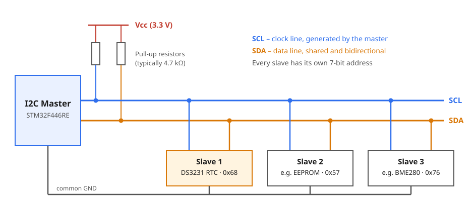
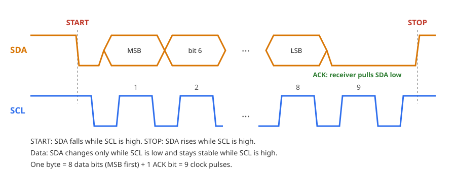
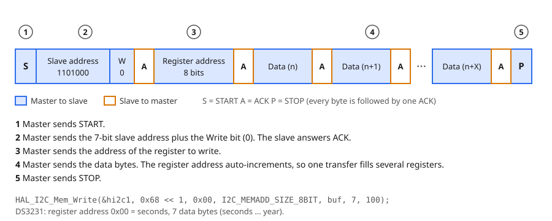
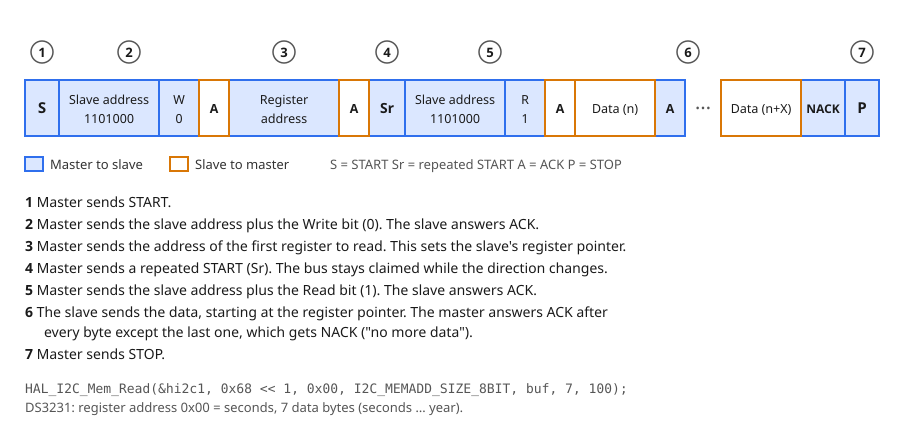
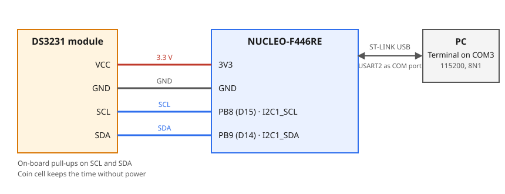

# 7.1a — I2C: DS3231 Real-Time Clock

**Board:** Nucleo-F446RE (STM32F446RETx)
**IDE:** STM32CubeIDE (GCC / make)

## Learning goal

This project teaches **how the I2C bus works and how to read and write the registers of an I2C device**, using a DS3231 real-time clock (RTC), and how to put that device driver in its own library.

After this project you can:
- explain how I2C shares two wires between several devices with addresses and ACK bits
- wire a DS3231 module to the Nucleo and configure `I2C1` in CubeMX
- read and write a device's registers with `HAL_I2C_Mem_Read` and `HAL_I2C_Mem_Write`, decoding BCD on the way
- write a small `ds3231` library that hides the register details from `main.c`

## Overview

The board prints the time to the PC once per second through the ST-LINK virtual COM port. Pressing the blue button **B1** writes a fixed preset time into the DS3231:

```
Wed 04/11/2026 14:30:00
Wed 04/11/2026 14:30:01
Wed 04/11/2026 14:30:02
```

## Theory

### The DS3231 module

The **DS3231** is a real-time clock chip with a built-in temperature-compensated crystal, accurate to about ±2 ppm (roughly one minute per year) between 0 and 40 °C. It counts seconds, minutes, hours, weekday, date, month and year, with leap years handled until 2100. It runs from 2.3 to 5.5 V and talks I2C at up to 400 kHz. Its address is fixed at `0x68`.

A **coin cell** on the module powers the clock when the board is off, so the time survives power loss. Common breakout modules also carry the pull-up resistors for SCL and SDA and an AT24C32 EEPROM (address `0x57`). Their pins are `32K`, `SQW`, `SCL`, `SDA`, `VCC` and `GND`; this project uses the last four.

The chip is controlled through registers. The first seven hold the time:

| Address | Content | Range |
|---|---|---|
| `0x00` | seconds | 00–59 |
| `0x01` | minutes | 00–59 |
| `0x02` | hours | 00–23 (24-hour mode) |
| `0x03` | day of week | 1–7 |
| `0x04` | date | 01–31 |
| `0x05` | month | 01–12 |
| `0x06` | year | 00–99 |

The remaining registers (`0x07`–`0x12`) hold alarms, control and status bits and the temperature; this project does not use them.

The chip keeps an internal **register pointer**. Every transfer first sets the pointer, and after each byte the pointer moves to the next register. One transfer can therefore read or write all seven time registers. Reading them in one transfer also gives a consistent snapshot: the chip copies the time into a buffer when the transfer starts, so you never mix `12:59:59` with `13:00:00`.

### BCD

The DS3231 stores each value in **BCD** (binary-coded decimal): every decimal digit takes 4 bits. The value 45 is stored as `0100 0101` = `0x45`, not as `0x2D`.

```
BCD -> decimal: (value >> 4) * 10 + (value & 0x0F)
decimal -> BCD: ((value / 10) << 4) | (value % 10)
```

Some registers also hold flag bits next to the value, which must be masked off when reading:

| Register | Flag | Mask to keep the value |
|---|---|---|
| hours | bit 6 selects 12/24-hour mode | `& 0x3F` |
| month | bit 7 is the century flag | `& 0x1F` |
| seconds, minutes | bit 7 is always 0 | `& 0x7F` |

### How I2C works

**I2C** (Inter-Integrated Circuit) connects many devices with only two wires. One device is the **master** (the STM32); it starts every transfer and generates the clock. The others are **slaves** (the DS3231). Every slave has a 7-bit **address**, and the master picks which slave answers by sending that address first.



- **SCL** is the clock line, driven by the master.
- **SDA** is the data line, shared in both directions.
- Both lines are **open-drain**: a device can only pull a line low, and a **pull-up resistor** brings it back high when nobody pulls. This lets many devices share a line without short circuits, and it is why the resistors are required.

Every byte is sent as 8 bits, most significant bit first, followed by a 9th clock in which the receiver answers with an **ACK** (SDA pulled low) or a **NACK** (SDA left high).



- **START**: SDA falls while SCL is high. **STOP**: SDA rises while SCL is high. These are the only times SDA may change while SCL is high.
- Data bits change while SCL is low and are read while SCL is high.

At 100 kHz one byte (9 clocks) takes about 90 µs, so the 10 bytes of a time read take about 1 ms.

**Writing registers.** The first byte after START is the slave address plus a direction bit: `0` for write. For the DS3231, `1101000` (`0x68`) plus `0` is `0xD0` on the wire.



**Reading registers.** The master cannot say "read register 3" in one step, so it first writes the register address to set the slave's pointer, then sends a **repeated START (Sr)** and addresses the slave again with the read bit `1` (`0xD1`). The slave now sends data from the pointer onwards. The master ACKs every byte except the last, whose NACK tells the slave to stop.



HAL builds both transactions for you:

| HAL function | What goes on the bus |
|---|---|
| `HAL_I2C_IsDeviceReady` | START, address, wait for ACK, STOP (checks the device is present) |
| `HAL_I2C_Mem_Write` | the write transaction above |
| `HAL_I2C_Mem_Read` | the read transaction above, including the repeated START |

HAL expects the address in 8-bit form, the 7-bit address shifted left by one (`0x68 << 1`). It fills in the R/W bit itself.

## Hardware & wiring

| Signal | Nucleo pin | Notes |
|---|---|---|
| DS3231 `VCC` | 3V3 | 3.3 V keeps SDA/SCL at 3.3 V logic |
| DS3231 `GND` | GND | |
| DS3231 `SCL` | PB8 (D15) | `I2C1_SCL` |
| DS3231 `SDA` | PB9 (D14) | `I2C1_SDA` |



- The time is printed on `USART2` (PA2/PA3), which the ST-LINK forwards to a COM port on the PC; no extra wire or module is needed. Terminal: `115200, 8N1, no flow control`.
- Some DS3231 modules charge the coin cell through a resistor. Use a rechargeable LIR2032, or a module without the charger, when the cell is not rechargeable.

## CubeMX setup

1. `File → New → STM32 Project` → Board Selector → **NUCLEO-F446RE** → Next → name it `7_1_a_I2C_DS3231` → answer **Yes** to "Initialize all peripherals with their default Mode".
2. **Connectivity → I2C1**: Mode = `I2C`. Check the pinout shows **PB8 = I2C1_SCL** and **PB9 = I2C1_SDA**; if CubeMX chose PB6/PB7, reset those pins and click PB8 and PB9 instead. **I2C Speed Mode** = `Standard Mode`, **Clock Speed** = `100000`. Wrong pins build and run but the chip is never found.
3. **Connectivity → USART2**: Mode = `Asynchronous` on PA2/PA3, **Baud Rate** = `115200`, 8 bits, no parity, 1 stop bit (already the default on this board).
4. Click **PC13** on the chip view, set it to `GPIO_Input`, then right-click it → **Enter User Label** → `B1`. Without the label `B1_Pin` is not generated.
5. **Project Manager → Project** → Toolchain / IDE = `STM32CubeIDE`. With any other toolchain CubeMX copies the whole CMSIS pack and the build fails.
6. **Project Manager → Code Generator** → **`Copy only the necessary library files`**.
7. **GENERATE CODE**.

## Code

The `ds3231` library knows only I2C; `main.c` knows the button and the UART. Create `Core/Inc/ds3231.h` and `Core/Src/ds3231.c` (CubeIDE already searches `Core/Inc` and builds `Core/Src`). In `main.c` write only between the `USER CODE BEGIN/END` markers; code outside them is lost when CubeMX regenerates ([which block holds what](../README.md#user-code-blocks)).

| Marker in `main.c` | Code |
|---|---|
| `Includes` | `<stdio.h>`, `ds3231.h` |
| `PV` | `DS3231_Time now`, `last_second`, `preset` |
| `2` | `DS3231_Init(&hi2c1)` and its error message |
| `3` | read and print the time, check B1, `HAL_Delay(100)` |

### API

`ds3231.h` holds the `DS3231_Time` struct (`second`, `minute`, `hour`, `day` with 1 = Sunday, `date`, `month`, `year` as 0–99 meaning 2000 + year) and these prototypes behind an include guard (`#ifndef` … `#endif`).

| Function | Parameters | Returns | Purpose |
|---|---|---|---|
| `DS3231_Init` | `I2C_HandleTypeDef *hi2c` | `HAL_StatusTypeDef` | Keep the handle, check that the chip answers |
| `DS3231_GetTime` | `DS3231_Time *time` | `HAL_StatusTypeDef` | Read the seven time registers in one transfer |
| `DS3231_SetTime` | `const DS3231_Time *time` | `HAL_StatusTypeDef` | Write the seven time registers in one transfer |
| `DS3231_DayOfWeek` | `date`, `month`, full `year` | `uint8_t` (1–7) | Compute the weekday so nobody has to type it |

The library keeps the `I2C_HandleTypeDef *` it receives in a `static` variable, because the parameter of `DS3231_Init` disappears when it returns. Call `Init` before any other function: until then the pointer is `NULL`.

### Build order

Test every stage on the board before starting the next.

**Stage 1: find the chip (no library yet).** In `USER CODE 2`, ask the bus whether address `0x68` answers and print the result.
```c
HAL_I2C_IsDeviceReady(&hi2c1, 0x68 << 1, 3, 10) == HAL_OK   // handle, address, tries, ms per try
HAL_UART_Transmit(&huart2, (uint8_t *)buf, n, HAL_MAX_DELAY);
```
`0x68 << 1` is the 7-bit address in the 8-bit form HAL expects. `n` is the length `snprintf` returned for the text in `buf`. *Test:* the terminal shows `DS3231 found`. If it shows `not found`, check power, SCL/SDA and the CubeMX pins before writing any more code.

**Stage 2: read the time (`DS3231_Init`, `DS3231_GetTime`).**
1. `Init`: store the handle, then probe the address as in stage 1 and return the result.
2. `GetTime`: read 7 bytes from register `0x00` in one call; on a HAL error return it and leave the caller's struct untouched.
3. Mask the flag bits, then convert each byte from BCD.
```c
HAL_I2C_Mem_Read(ds3231_i2c, 0x68 << 1, 0x00, I2C_MEMADD_SIZE_8BIT, buf, 7, 100);
time->hour = bcd_to_dec(buf[2] & 0x3F);   // month: & 0x1F, seconds and minutes: & 0x7F
```
Parameters in order: handle, address, register address, register-address size, buffer, length, timeout in ms. *Watch out:* define the address as `(0x68 << 1)` with the parentheses, or operator precedence breaks the macro inside larger expressions.

In the loop, poll every 100 ms and print only when the second changes. That gives exactly one line per second, locked to the DS3231's own clock; `HAL_Delay(1000)` would drift against it.
```c
if (DS3231_GetTime(&now) == HAL_OK && now.second != last_second) { last_second = now.second; /* print */ }
```
`last_second` starts at `0xFF`, a value no real second can have, so the first reading always prints. *Test:* one line per second; the date may be wrong until stage 3.

**Stage 3: set the time (`DS3231_SetTime`, button B1).**
1. Convert each field to BCD with a private `dec_to_bcd()` (formula in Theory).
2. Send all seven bytes in one write transaction.
```c
HAL_I2C_Mem_Write(ds3231_i2c, 0x68 << 1, 0x00, I2C_MEMADD_SIZE_8BIT, buf, 7, 100);
```
Hour bit 6 stays 0, which keeps 24-hour mode. In the loop, a pressed B1 writes the `preset` struct (a `const DS3231_Time` in `PV`) and sets `last_second = 0xFF` so the new time prints at once.
```c
if (HAL_GPIO_ReadPin(B1_GPIO_Port, B1_Pin) == GPIO_PIN_RESET)   // B1 is active low
```
*Test:* pressing B1 makes the printed time jump to the preset and keep counting; unplug and replug USB and the time stays correct.

**Stage 4: weekday (`DS3231_DayOfWeek`).** Sakamoto's algorithm: add the year, the leap-year corrections and a fixed offset per month, take the remainder modulo 7, then add 1.
```c
(year + year/4 - year/100 + year/400 + offset[month - 1] + date) % 7 + 1   // 1 = Sunday
```
`offset` is `{0, 3, 2, 5, 0, 3, 5, 1, 4, 6, 2, 4}`, and `year` is reduced by 1 first when `month < 3`. Use it to fill `preset.day` before `SetTime`, and print a name from `{"", "Sun", …, "Sat"}`. *Test:* 04/11/2026 gives `2523 % 7 = 3`, plus 1 is 4, which prints `Wed`.

Reference solution: [Core/Inc/ds3231.h](Core/Inc/ds3231.h), [Core/Src/ds3231.c](Core/Src/ds3231.c), [Core/Src/main.c](Core/Src/main.c).

## Folder structure

```
7_1_a_I2C_DS3231/
├── Core/
│   ├── Inc/ds3231.h                    - driver API and DS3231_Time struct
│   └── Src/
│       ├── ds3231.c                    - register access, BCD, weekday
│       └── main.c                      - init, print loop, button B1
├── diagrams/                           - I2C and wiring diagrams used above
├── 7_1_a_I2C_DS3231.ioc                - CubeMX project (I2C1 on PB8/PB9, USART2, PC13 as B1)
└── README.md
```
