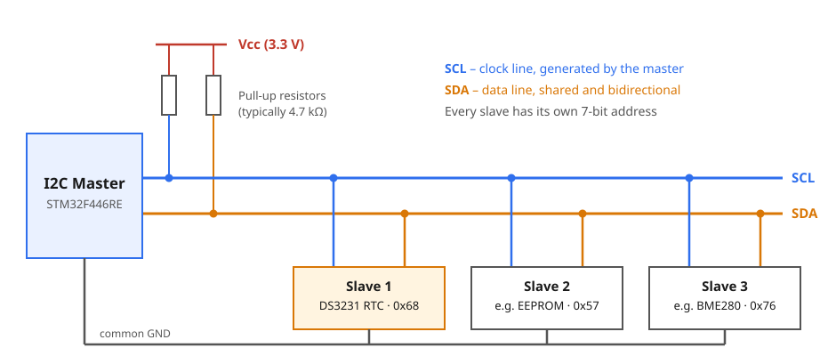
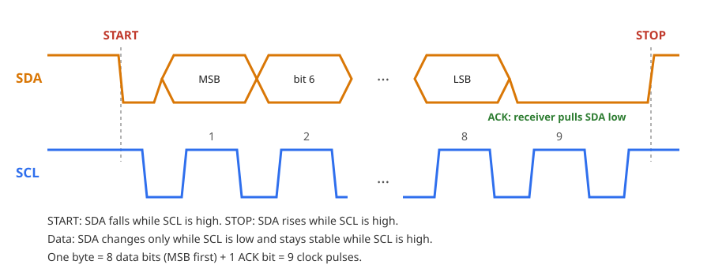
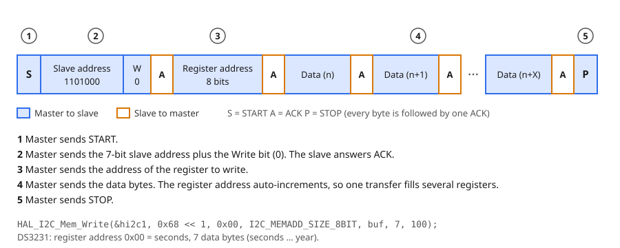
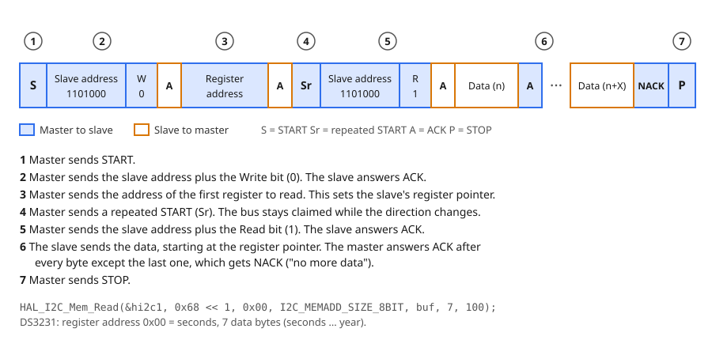
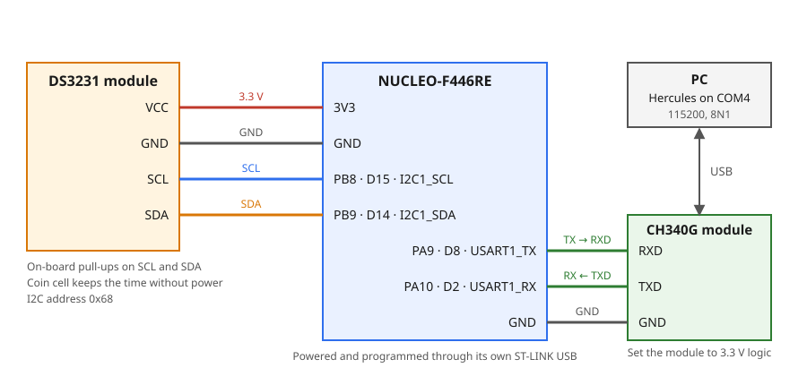

# 7.2 — I2C: DS3231 Real-Time Clock over UART

**Board:** Nucleo-F446RE (STM32F446RETx)
**IDE:** STM32CubeIDE (GCC / make)

## Learning goal

This project teaches **how the I2C bus works and how to read and write the registers of an I2C device**, using a DS3231 real-time clock (RTC). It also shows how to keep each device driver in its own library and join the libraries in `main.c`.

After this project you can:
- explain how I2C shares two wires between several devices with addresses and ACK bits
- read and write a device's registers with `HAL_I2C_Mem_Read` and `HAL_I2C_Mem_Write`, decoding BCD values on the way
- wire a DS3231 module and a CH340G module to the Nucleo
- build a project from two independent libraries (`ds3231`, `ch340g`) glued together in `main.c`

## Overview

The board reads the time from the DS3231 and prints it to the PC once per second as `dd/mm/yyyy hh:mm:ss`. The PC can set the time by sending a text command:

```
02/11/2026 18:52:12
02/11/2026 18:52:13
SET 03/11/2026 09:15:00        <- typed in the terminal
Time set
03/11/2026 09:15:00
```

## Theory

### The DS3231 module

The **DS3231** is a real-time clock chip with a built-in temperature-compensated crystal, accurate to about ±2 ppm (roughly one minute per year) between 0 and 40 °C. It counts seconds, minutes, hours, weekday, date, month and year, with leap years handled until 2100. It runs from 2.3 to 5.5 V and talks I2C at up to 400 kHz. Its address is fixed at `0x68`.

A **coin cell** on the module powers the clock when the board is off, so the time survives power loss. Common breakout modules also carry the pull-up resistors for SCL and SDA and an AT24C32 EEPROM (address `0x57`). Their pins are `32K`, `SQW`, `SCL`, `SDA`, `VCC` and `GND`; this project uses the last four.

The chip is controlled through registers. The first seven hold the time:

| Address | Content | Range |
|---|---|---|
| `0x00` | seconds | 00–59 |
| `0x01` | minutes | 00–59 |
| `0x02` | hours | 00–23 (24-hour mode) |
| `0x03` | day of week | 1–7 |
| `0x04` | date | 01–31 |
| `0x05` | month | 01–12 |
| `0x06` | year | 00–99 |

The remaining registers (`0x07`–`0x12`) hold alarms, control and status bits and the temperature; this project does not use them.

The chip keeps an internal **register pointer**. Every transfer first sets the pointer, and after each byte the pointer moves to the next register. One transfer can therefore read or write all seven time registers. Reading them in one transfer also gives a consistent snapshot: the chip copies the time into a buffer when the transfer starts, so you never mix `12:59:59` with `13:00:00`.

### BCD

The DS3231 stores each value in **BCD** (binary-coded decimal): every decimal digit takes 4 bits. The value 45 is stored as `0100 0101` = `0x45`, not as `0x2D`.

```
BCD -> decimal: (value >> 4) * 10 + (value & 0x0F)
decimal -> BCD: ((value / 10) << 4) | (value % 10)
```

Some registers also hold flag bits next to the value, which must be masked off when reading:

| Register | Flag | Mask to keep the value |
|---|---|---|
| hours | bit 6 selects 12/24-hour mode | `& 0x3F` |
| month | bit 7 is the century flag | `& 0x1F` |
| seconds, minutes | bit 7 is always 0 | `& 0x7F` |

### How I2C works

**I2C** (Inter-Integrated Circuit) connects many devices with only two wires. One device is the **master** (the STM32); it starts every transfer and generates the clock. The others are **slaves** (the DS3231). Every slave has a 7-bit **address**, and the master picks which slave answers by sending that address first.



- **SCL** is the clock line, driven by the master.
- **SDA** is the data line, shared in both directions.
- Both lines are **open-drain**: a device can only pull a line low, and a **pull-up resistor** brings it back high when nobody pulls. This lets many devices share a line without short circuits, and it is why the resistors are required.

Every byte is sent as 8 bits, most significant bit first, followed by a 9th clock in which the receiver answers with an **ACK** (SDA pulled low) or a **NACK** (SDA left high).



- **START**: SDA falls while SCL is high. **STOP**: SDA rises while SCL is high. These are the only times SDA may change while SCL is high.
- Data bits change while SCL is low and are read while SCL is high.

At 100 kHz one byte (9 clocks) takes about 90 µs, so the 10 bytes of a time read take about 1 ms.

**Writing registers.** The first byte after START is the slave address plus a direction bit: `0` for write. For the DS3231, `1101000` (`0x68`) plus `0` is `0xD0` on the wire.



**Reading registers.** The master cannot say "read register 3" in one step, so it first writes the register address to set the slave's pointer, then sends a **repeated START (Sr)** and addresses the slave again with the read bit `1` (`0xD1`). The slave now sends data from the pointer onwards. The master ACKs every byte except the last, whose NACK tells the slave to stop.



HAL builds both transactions for you:

| HAL function | What goes on the bus |
|---|---|
| `HAL_I2C_IsDeviceReady` | START, address, wait for ACK, STOP (checks the device is present) |
| `HAL_I2C_Mem_Write` | the write transaction above |
| `HAL_I2C_Mem_Read` | the read transaction above, including the repeated START |

HAL expects the address in 8-bit form, the 7-bit address shifted left by one (`0x68 << 1`). It fills in the R/W bit itself.

### UART in this project

The UART frame, baud rate and TX/RX crossing are explained in [6_1_UART_HELLO_WORLD](../6_1_UART_HELLO_WORLD), and the interrupt-driven receive pattern in [6_2_UART_Control_LED](../6_2_UART_Control_LED). Here USART1 runs at 115200, 8N1 again. Two things are new: sending formatted text with `vsnprintf`, and receiving a whole command line, which is considered complete when a CR/LF arrives or the line has been quiet for 50 ms.

## Hardware & wiring

| Signal | Nucleo pin | Notes |
|---|---|---|
| DS3231 `VCC` | 3V3 | 3.3 V keeps SDA/SCL at 3.3 V logic |
| DS3231 `GND` | GND | |
| DS3231 `SCL` | PB8 (D15) | `I2C1_SCL` |
| DS3231 `SDA` | PB9 (D14) | `I2C1_SDA` |
| CH340G `RXD` | PA9 (D8) | `USART1_TX` |
| CH340G `TXD` | PA10 (D2) | `USART1_RX` |
| CH340G `GND` | GND | Shared ground |



- TX goes to RXD and RX to TXD (crossed). Set the CH340G module to **3.3 V** logic and leave its `VCC` unconnected; USB powers it. It appears as its own COM port (the ST-LINK has a separate one that is not used here). Terminal: `115200, 8N1, no flow control`.
- Some DS3231 modules charge the coin cell through a resistor. Use a rechargeable LIR2032, or a module without the charger, when the cell is not rechargeable.

## CubeMX setup

1. `File → New → STM32 Project` → Board Selector → **NUCLEO-F446RE** → Next → name it `7_2_I2C_UART` → finish the wizard.
2. **Connectivity → I2C1**: Mode = `I2C`. Check the pinout shows **PB8 = I2C1_SCL** and **PB9 = I2C1_SDA** (re-pick them if CubeMX chose PB6/PB7). **I2C Speed Mode** = `Standard Mode`, **Clock Speed** = `100000`.
3. **Connectivity → USART1**: Mode = `Asynchronous`. Pinout **PA9 = USART1_TX**, **PA10 = USART1_RX**. **Baud Rate** = `115200`, **Word Length** = `8 Bits`, **Parity** = `None`, **Stop Bits** = `1`.
4. **USART1 → NVIC Settings** → tick **USART1 global interrupt**. Without it the board never receives a byte and nothing reports an error.
5. **Project Manager → Project** → Toolchain / IDE = `STM32CubeIDE`.
6. **Project Manager → Code Generator** → **`Copy only the necessary library files`**.
7. **GENERATE CODE**.

## Code

`ds3231` knows only I2C and `ch340g` knows only UART; `main.c` is the only place that knows both, so either library moves to another project unchanged. Create the four library files in `Core/Inc` and `Core/Src` (CubeIDE already searches both). In `main.c`, write only between the `USER CODE BEGIN/END` markers; code outside them is lost when CubeMX regenerates.

Reference solution: [ds3231.h](Core/Inc/ds3231.h), [ds3231.c](Core/Src/ds3231.c), [ch340g.h](Core/Inc/ch340g.h), [ch340g.c](Core/Src/ch340g.c), [main.c](Core/Src/main.c).

### `ds3231` library

The header sits behind an include guard (`#ifndef` … `#endif`) and includes `main.h` for the HAL types. `DS3231_Time` is a struct of seven `uint8_t` fields: `second`, `minute`, `hour`, `day` (weekday, 1 = Sunday), `date`, `month` and `year` (0–99, meaning 2000 + year). Every function returns `HAL_StatusTypeDef`, so `main.c` can tell when the bus fails (loose wire, unpowered module). The library keeps the `I2C_HandleTypeDef *` it is given in a `static` variable, because the parameter of `Init` disappears when it returns.

| Function | Parameters | Returns | Purpose |
|---|---|---|---|
| `DS3231_Init` | `I2C_HandleTypeDef *hi2c` | `HAL_StatusTypeDef` | Keep the handle, check that the chip answers |
| `DS3231_SetTime` | `const DS3231_Time *time` | `HAL_StatusTypeDef` | Write the seven time registers in one transfer |
| `DS3231_GetTime` | `DS3231_Time *time` | `HAL_StatusTypeDef` | Read the seven time registers in one transfer |
| `DS3231_DayOfWeek` | `date`, `month`, full `year` | `uint8_t` (1–7) | Compute the weekday so the user does not type it |

- **`DS3231_Init`**: 1) store the handle; 2) probe the address with `HAL_I2C_IsDeviceReady(hi2c, 0x68 << 1, 3, 10)` (3 tries, 10 ms each), so a missing chip is reported at start-up instead of later.
- **`DS3231_SetTime`**: 1) convert each field to BCD with a private `dec_to_bcd()` (formula in Theory); 2) send all seven bytes in one write transaction.
  ```c
  HAL_I2C_Mem_Write(ds3231_i2c, 0x68 << 1, 0x00, I2C_MEMADD_SIZE_8BIT, buf, 7, 100);
  ```
  Parameters in order: handle, 8-bit address, register address, register-address size, data, length, timeout in ms. Hour bit 6 stays 0, which keeps 24-hour mode.
- **`DS3231_GetTime`**: 1) read 7 bytes from register `0x00` in one call (one transfer is one consistent snapshot); 2) on a HAL error return it and leave the caller's struct untouched; 3) mask the flag bits, then convert each byte from BCD.
  ```c
  HAL_I2C_Mem_Read(ds3231_i2c, 0x68 << 1, 0x00, I2C_MEMADD_SIZE_8BIT, buf, 7, 100);
  time->hour = bcd_to_dec(buf[2] & 0x3F);   // month: & 0x1F, seconds and minutes: & 0x7F
  ```
  *Watch out:* without the masks the 12/24-hour and century flags corrupt the value. Define the address as `(0x68 << 1)` with the parentheses, or operator precedence breaks the macro inside larger expressions.
- **`DS3231_DayOfWeek`**: Sakamoto's algorithm. Add the year, the leap-year corrections and a fixed offset per month, take the remainder modulo 7, then add 1.
  ```c
  (year + year/4 - year/100 + year/400 + offset[month - 1] + date) % 7   // 0 = Sunday
  ```
  `offset` is `{0, 3, 2, 5, 0, 3, 5, 1, 4, 6, 2, 4}`, and `year` is reduced by 1 first when `month < 3`. Check: 02/11/2026 gives `2521 % 7 = 1`, plus 1 is 2, a Monday.

### `ch340g` library

The CH340G is only a USB-to-UART chip, so this library wraps `USART1`. `CH340G_RX_LINE_SIZE` (40) lives in the header because `main.c` needs it for its own buffer.

| Function | Parameters | Returns | Purpose |
|---|---|---|---|
| `CH340G_Init` | `UART_HandleTypeDef *huart` | – | Keep the handle, arm reception of one byte |
| `CH340G_Send` | `const char *str` | `HAL_StatusTypeDef` | Send a fixed string |
| `CH340G_Printf` | `const char *fmt, ...` | `HAL_StatusTypeDef` | Format like `printf`, then send |
| `CH340G_ReadLine` | `char *line`, `uint16_t size` | `uint8_t` | 1 and a copy of the command when a full line has arrived, else 0 |
| `CH340G_RxCallback` | `UART_HandleTypeDef *huart` | – | Forward `HAL_UART_RxCpltCallback` here |
| `CH340G_ErrorCallback` | `UART_HandleTypeDef *huart` | – | Forward `HAL_UART_ErrorCallback` here |

- **`CH340G_Init` and `CH340G_Send`**: store the handle and call `HAL_UART_Receive_IT(huart, &rx_byte, 1)`; `Send` is `HAL_UART_Transmit` with `strlen(str)` as the length. Call `Init` before any `Send`: until then the handle is `NULL` and the program hangs.
- **`CH340G_Printf`**: 1) format into a 64-byte buffer with `vsnprintf`; 2) if the result is negative return `HAL_ERROR`; if it is larger than the buffer the text was cut, so send only what fits; 3) transmit that many bytes.
  ```c
  va_start(args, fmt);
  int n = vsnprintf(buf, sizeof(buf), fmt, args);   // returns the length it WOULD have written
  va_end(args);
  ```
- **`CH340G_RxCallback`** (interrupt side): 1) return if the UART is not ours; 2) on `'\r'` or `'\n'`, if at least one character is collected, terminate the string and set `line_ready`; 3) otherwise append the character and remember the time; 4) re-arm. While `line_ready` is 1, new bytes are dropped.
  ```c
  rx_line[rx_len++] = (char)rx_byte;
  rx_tick = HAL_GetTick();                         // when the last character arrived
  HAL_UART_Receive_IT(ch340g_uart, &rx_byte, 1);   // re-arm, or the next byte is lost
  ```
  *Watch out:* `HAL_UART_Receive_IT` receives **one** byte and stops. `line_ready` and `rx_tick` are `volatile` because the interrupt writes them where the main loop cannot see it.
- **`CH340G_ErrorCallback`**: an overrun cancels the armed reception, so clear it with `__HAL_UART_CLEAR_OREFLAG(huart)` and re-arm; otherwise the UART goes deaf while sending still works.
- **`CH340G_ReadLine`** (main-loop side): 1) with interrupts briefly off, if no CR/LF came but a line exists and 50 ms (`CH340G_RX_IDLE_MS`) passed since its last character, mark it complete; 2) if no line is ready, return 0; 3) copy it out, reset `rx_len` first, then clear `line_ready` so the interrupt can start the next line.
  ```c
  __disable_irq();   // the ISR must not add a character while we check
  if (!line_ready && rx_len > 0 && (HAL_GetTick() - rx_tick) >= CH340G_RX_IDLE_MS)
  ```
  The quiet-time rule makes every terminal work: one may send CR, LF, both, or nothing (Hercules sends the text only).

### `main.c`

Place the code in these markers:

| Marker | Code |
|---|---|
| `Includes` | `<stdio.h>` (for `sscanf`), `ds3231.h`, `ch340g.h` |
| `PV` | `DS3231_Time now`, `uint8_t last_second = 0xFF` (an impossible value, so the first reading prints), `char line[CH340G_RX_LINE_SIZE]` |
| `0` | `handle_command()` |
| `2` | `CH340G_Init(&huart1)` **first** (every message needs it), then `DS3231_Init(&hi2c1)`; on failure send `DS3231 not found`; send the usage line |
| `3` (in the loop) | read a command, print the time, `HAL_Delay(100)` |
| `4` | the two HAL callbacks |

- **`handle_command(cmd)`**: 1) `sscanf` must read exactly 6 numbers; 2) check each range on both sides, because `%d` also accepts negative numbers (days per month are not checked, so `31/02/2026` passes); 3) build a `DS3231_Time` with `.day = DS3231_DayOfWeek(...)` and `.year = y - 2000`; 4) `DS3231_SetTime`, reply `Time set` and set `last_second = 0xFF` so the new time prints at once. A bad line gets the usage message.
  ```c
  int valid = (sscanf(cmd, "SET %d/%d/%d %d:%d:%d", &d, &mo, &y, &h, &mi, &s) == 6)
           && d >= 1 && d <= 31 && mo >= 1 && mo <= 12 /* ... one pair per field */;
  ```
- **Loop**: 1) `if (CH340G_ReadLine(line, sizeof(line)))` call `handle_command`; 2) read the time and print it only when `second` changed; 3) `HAL_Delay(100)`.
  ```c
  if (DS3231_GetTime(&now) == HAL_OK && now.second != last_second)
  {
    last_second = now.second;
    CH340G_Printf("%02d/%02d/%04d %02d:%02d:%02d\r\n", now.date, now.month,
                  2000 + now.year, now.hour, now.minute, now.second);
  }
  ```
  Polling every 100 ms and printing on change gives exactly one line per second, locked to the DS3231's clock. `HAL_Delay(1000)` would drift against it and sometimes repeat or skip a second.
- **Callbacks**: `HAL_UART_RxCpltCallback` calls `CH340G_RxCallback(huart)` and `HAL_UART_ErrorCallback` calls `CH340G_ErrorCallback(huart)`. A weak HAL function can be overridden only once per program, so `main.c` owns the definitions and forwards to the libraries.

## Folder structure

```
7_2_I2C_UART/
├── Core/Inc/ds3231.h, Core/Src/ds3231.c   - DS3231 driver: BCD, register read/write, day of week
├── Core/Inc/ch340g.h, Core/Src/ch340g.c   - UART library: formatted send, line receive by interrupt
├── Core/Src/main.c                        - glue: SET command, one print per second
├── 7_2_I2C_UART.ioc                          - CubeMX project (I2C1 on PB8/PB9, USART1 on PA9/PA10 + interrupt)
└── diagrams/                              - i2c_bus, i2c_bit_timing, i2c_write, i2c_read, wiring_diagram (.svg)
```
