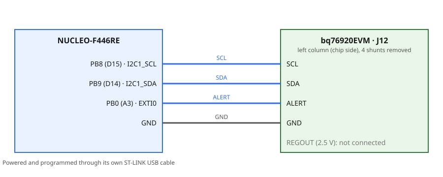
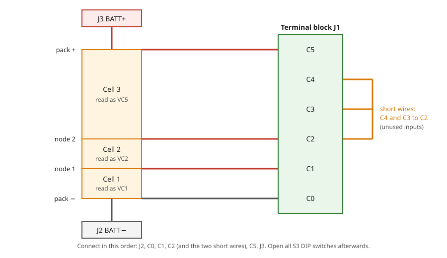

# 8.1 — BMS: Reading Cell Voltages with the bq76920

**Board:** Nucleo-F446RE (STM32F446RETx) + bq76920EVM
**IDE:** STM32CubeIDE (GCC / make)

## Learning goal

This project teaches **how to read the cell voltages of a battery pack from a battery-monitor chip (AFE) over I2C**, and how to put that chip's driver in its own library.

After this project you can:
- explain what a battery-monitor AFE measures and why its ADC needs factory gain and offset
- connect a 3-cell Li-ion pack to the bq76920 EVM and wire the Nucleo to it
- read the cell registers of the bq76920 and convert them to millivolts
- write a small `bq76920` library that hides the register details from `main.c`

## Overview

Every second the board prints the voltage of each cell input to the PC through the ST-LINK virtual COM port:

```
VC1=4074 VC2=4076 VC3=48 VC4=47 VC5=3950 mV
Cell1=4074 Cell2=4076 Cell3=3950 Pack=12100 mV (unused: 48 47)
```

## Theory

I2C and `HAL_I2C_Mem_Read` are explained in [7_1_a_I2C_DS3231](../7_1_a_I2C_DS3231). Only what is new is described here.

### The bq76920

The **bq76920** is an analog front end (AFE) for packs of 3 to 5 Li-ion cells. It measures every cell with a 14-bit ADC and can also measure pack current, temperature and drive the charge and discharge FETs. It does not decide anything itself: the microcontroller reads its registers over I2C (7-bit address `0x08`) and acts on them. This project uses only the cell voltages.

The chip sleeps (**SHIP mode**) until its `BOOT` pin is pulled high. On the EVM the `Boot` button does that. After waking, the ADC must be switched on in `SYS_CTRL1` (bit `ADC_EN`) and `CC_CFG` must be set to `0x19`, otherwise every register reads 0.

### From register to millivolts

Each cell input has two registers, `VCx_HI` and `VCx_LO` (`0x0C` to `0x15`). The 14-bit value is `((HI & 0x3F) << 8) | LO`. The ADC step differs slightly from chip to chip, so the factory stores a gain and an offset in the chip:

```
GAIN (µV/LSB) = 365 + ((ADCGAIN1 & 0x0C) << 1) + ((ADCGAIN2 & 0xE0) >> 5)
V (mV)        = ADC × GAIN / 1000 + ADCOFFSET        (ADCOFFSET is signed, in mV)
```

Example: `ADC = 10500`, `GAIN = 382 µV`, `ADCOFFSET = +10 mV` gives `10500 × 382 / 1000 + 10 = 4021 mV`. The value is the voltage **of that one cell**, not the sum from the bottom.

### Fewer than five cells

The chip always reports five cell inputs. For fewer cells the unused inputs must be shorted to a neighbour, and the used cells use fixed inputs:

| Cells | Inputs used |
|---|---|
| 3 | `VC1`, `VC2`, `VC5` |
| 4 | `VC1`, `VC2`, `VC3`, `VC5` |
| 5 | `VC1` to `VC5` |

Shorted inputs read close to 0 mV.

### Logic level

The EVM carries the 2.5 V version of the chip, so `SDA`, `SCL` and `ALERT` are 2.5 V signals and the pull-ups on the EVM go to `REGOUT` (2.5 V). The STM32 only pulls SDA/SCL low (open-drain), and 2.5 V is above its input threshold, so no level shifter is needed.

## Hardware & wiring

| Signal | Nucleo pin | EVM |
|---|---|---|
| `SCL` | PB8 (D15) | `J12`, left column, row `SCL` |
| `SDA` | PB9 (D14) | `J12`, left column, row `SDA` |
| `ALERT` | PB0 (A3) | `J12`, left column, row `ALERT` |
| `GND` | GND | `J12`, row `GND` |



Prepare the EVM before connecting anything:
1. Remove the four shunts on `J12`. They connect the on-board gauge chip to the bus; the gauge would act as a second I2C master.
2. Keep the shunts on the `SCL` and `SDA` pull-up headers.
3. Do not connect `REGOUT` to the Nucleo. The EVM and the Nucleo share only `GND` and the signals.



Connect the pack in the order shown, then **open all `S3` DIP switches**. They switch the cell-simulator resistors, which would drain real cells (the orange LED `D21` lights while they do). The chip is powered from the top cell, so no other supply is needed. Press and release `Boot` after the pack is connected. Terminal: `115200, 8N1, no flow control`.

## CubeMX setup

1. `File → New → STM32 Project` → Board Selector → **NUCLEO-F446RE** → name it `8_1_BMS_Control` → **Yes** to "Initialize all peripherals with their default Mode".
2. **Connectivity → I2C1**: Mode = `I2C`, **Standard Mode**, **Clock Speed** = `100000`. Check **PB8 = I2C1_SCL** and **PB9 = I2C1_SDA**; if CubeMX chose PB6/PB7, reset them and click PB8 and PB9. Wrong pins build and run but the chip is never found.
3. **Connectivity → USART2**: `Asynchronous`, `115200`, 8 bits, no parity, 1 stop bit.
4. Click **PB0** → `GPIO_EXTI0`; under **System Core → GPIO** set it to rising edge, pull-down, label `BMS_ALERT`; tick `EXTI line0 interrupt` in **NVIC**. Not used by this project, it only saves a trip back to CubeMX.
5. **Project Manager → Project** → Toolchain / IDE = `STM32CubeIDE`; **Code Generator** → `Copy only the necessary library files`. **GENERATE CODE**.

## Code

The `bq76920` library knows only I2C and the chip; `main.c` knows the UART and the layout of the pack. Create `Core/Inc/bq76920.h` and `Core/Src/bq76920.c`. Write in `main.c` only between the `USER CODE BEGIN/END` markers; code outside them is lost when CubeMX regenerates ([which block holds what](../README.md#user-code-blocks)).

| Marker in `main.c` | Code |
|---|---|
| `Includes` | `<stdio.h>`, `bq76920.h` |
| `PV` | `char buf[96]`, `uint16_t cell_mv[5]` |
| `2` | `BQ76920_Init(&hi2c1)` and a message for success or failure |
| `3` | `BQ76920_ReadCells`, print, `HAL_Delay(1000)` |

### API

| Function | Parameters | Returns | Purpose |
|---|---|---|---|
| `BQ76920_Init` | `I2C_HandleTypeDef *hi2c` | `HAL_StatusTypeDef` | Keep the handle, wake the ADC, read gain and offset |
| `BQ76920_ReadCells` | `uint16_t mv[5]` | `HAL_StatusTypeDef` | Read all five cell inputs, in mV |
| `BQ76920_ReadReg` | `uint8_t reg`, `uint8_t *val` | `HAL_StatusTypeDef` | Read one register (debugging) |

The library keeps the `I2C_HandleTypeDef *`, `gain_uv` and `offset_mv` in `static` variables. Call `Init` before any other function.

### Build order

Test every stage on the board before starting the next.

**Stage 1: find the chip (no library yet).** Scan the bus with `HAL_I2C_IsDeviceReady` and print every address that answers. *Test:* `0x08` appears. The chip must be awake (`Boot` pressed) before it answers.

**Stage 2: `BQ76920_Init`.**
1. Check that `0x08` answers.
2. Write `0x19` to `CC_CFG` (`0x0B`) and `ADC_EN` (`0x10`) to `SYS_CTRL1` (`0x04`).
3. Read `ADCGAIN1`, `ADCGAIN2`, `ADCOFFSET`; combine them with the formula above; wait 300 ms for the first conversion.
```c
HAL_I2C_Mem_Write(bq_i2c, 0x08 << 1, reg, I2C_MEMADD_SIZE_8BIT, &val, 1, 100);
```
*Test:* reading `CC_CFG` back returns `0x19`. *Watch out:* cast `ADCOFFSET` to `int8_t`, or negative offsets turn into large positive numbers.

**Stage 3: `BQ76920_ReadCells`.**
1. Read 10 bytes from `0x0C` in one call; the register address auto-increments and all cells come from one snapshot.
2. For each cell mask the high byte with `0x3F` and combine it with the low byte.
3. Apply gain and offset; clamp negative results to 0.
```c
uint16_t adc = ((raw[2 * i] & 0x3F) << 8) | raw[2 * i + 1];
int32_t  v   = (int32_t)adc * gain_uv / 1000 + offset_mv;
```
*Test:* each used input matches a multimeter on that cell within a few mV. *Watch out:* `& 0x3F` removes the two unused bits; without it the value is wrong by a large amount.

**Stage 4: print.** In `main.c` print the five raw inputs, then `Cell1`, `Cell2` and `Cell3` from `VC1`, `VC2` and `VC5` and their sum. *Test:* the pack total equals the multimeter reading across the pack.

Reference solution: [Core/Inc/bq76920.h](Core/Inc/bq76920.h), [Core/Src/bq76920.c](Core/Src/bq76920.c), [Core/Src/main.c](Core/Src/main.c).

## Folder structure

```
8_1_BMS_Control/
├── Core/
│   ├── Inc/bq76920.h                   - driver API
│   └── Src/
│       ├── bq76920.c                   - wake-up, gain and offset, cell conversion
│       └── main.c                      - init, one print per second
├── diagrams/                           - wiring and pack-connection diagrams
├── 8_1_BMS_Control.ioc                 - CubeMX project (I2C1 on PB8/PB9, USART2, PB0 EXTI)
└── README.md
```
