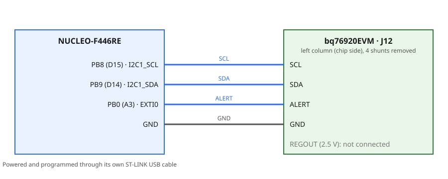
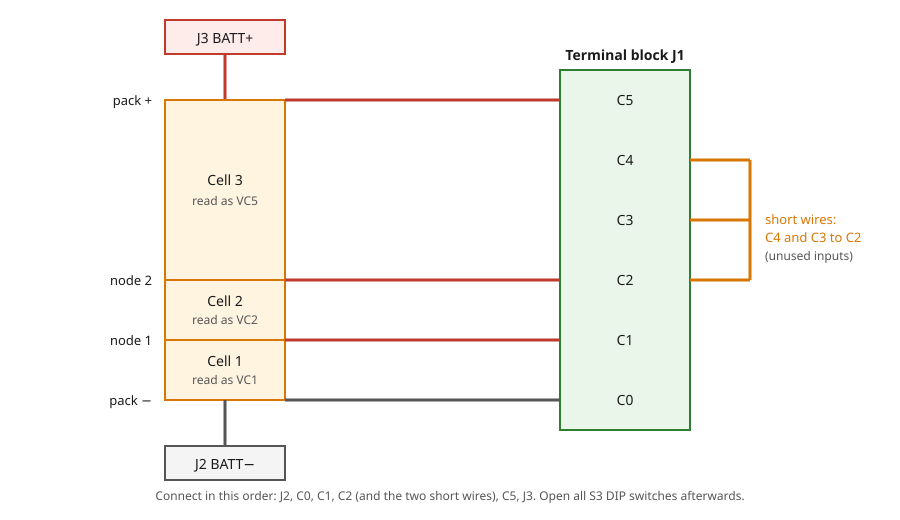
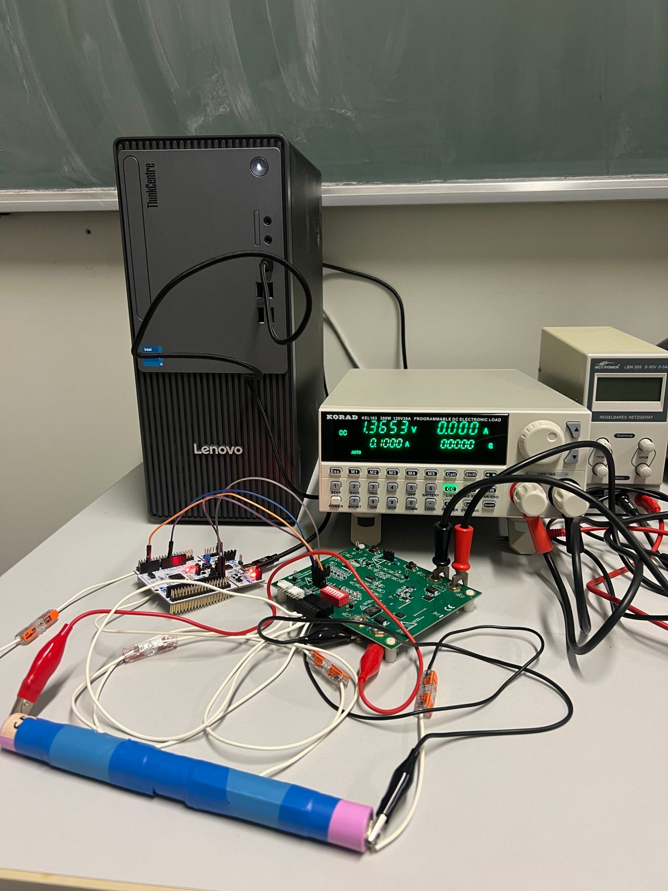

# 8.2 — BMS: Passive Cell Balancing with the bq76920

**Board:** Nucleo-F446RE (STM32F446RETx) + bq76920EVM
**IDE:** STM32CubeIDE (GCC / make)

## Learning goal

This project teaches **how passive cell balancing works and how a microcontroller runs it**: finding out how many cells a pack has, choosing which cells to bleed, and stopping when the pack is balanced.

After this project you can:
- explain why cells drift apart and how bleeding the highest cells evens them out
- switch the bleeders of the bq76920 with the `CELLBAL1` register
- detect the number of connected cells (3 to 5) from the cell voltages
- write a small `balance` library that runs a bleed and measure cycle without blocking

## Overview

The board prints every cell, announces the start, shows the cells every second while it balances, announces the end, and then keeps showing the cells and the pack total:

```
3 cells found
Cell1=4074 Cell2=4076 Cell3=3950 mV
Starting balancing
Cell1=4074 Cell2=4075 Cell3=3951 mV  bleeding: Cell2
...
Finish balancing
Cell1=4012 Cell2=4015 Cell3=4004 mV  Pack=12031 mV
```

The hardware, the pack connection and the `bq76920` driver are the same as in [8_1_BMS_Control](../8_1_BMS_Control); read it first.

## Theory

### Passive balancing

Cells in a series pack drift apart through small differences in capacity and self-discharge. The pack must stop charging when its **highest** cell is full, so a low cell limits the usable energy. **Passive balancing** removes energy from the higher cells by switching a resistor across them until they match the lowest cell. The energy is lost as heat, so it is slow: the bleed current is only tens of milliamps.

### The bleeders of the bq76920

Each cell input has an internal switch in series with the input filter resistors on the EVM. The register `CELLBAL1` (`0x01`) holds one bit per input: bit 0 = `CB1` (`VC1`) to bit 4 = `CB5` (`VC5`). Two rules:
- Never switch on two **neighbouring** inputs at once (for example `CB1` and `CB2`); bleed them in turns.
- A bleeding cell reads lower and its neighbour reads higher, so a reading taken while bleeding is wrong. Decide only from a reading taken with all bleeders off.

### The cycle

The chip does not balance by itself; the microcontroller decides every second:

```
rest 1 s: measure ──► highest − lowest ≤ 20 mV? ──yes──► Finish balancing
                       │ no
                       ▼
        choose cells to bleed ──► bleed 4 s (read and print each second) ──► rest 1 s ...
```

A cell is chosen when it is more than 20 mV above the lowest cell. Highest cells go first, and a cell is skipped when its neighbouring input is already chosen.

### Finding the cells

The chip always reports five inputs. Unused inputs are shorted to a neighbour and read near 0 mV, so any input at or above 1500 mV is a cell. With three cells the cells sit on `VC1`, `VC2` and `VC5`; the library keeps which chip input each cell uses.

## Hardware & wiring

Same wiring as [8.1](../8_1_BMS_Control): `PB8 (D15)` to `SCL`, `PB9 (D14)` to `SDA`, `PB0 (A3)` to `ALERT` (not used here) and `GND`, on the left column of `J12`, with the four shunts on `J12` removed.

| Signal | Nucleo pin | EVM |
|---|---|---|
| `SCL` | PB8 (D15) | `J12`, left column, row `SCL` |
| `SDA` | PB9 (D14) | `J12`, left column, row `SDA` |
| `ALERT` | PB0 (A3) | `J12`, left column, row `ALERT` |
| `GND` | GND | `J12`, row `GND` |






- Open all `S3` DIP switches after the pack is connected; press `Boot` once. Terminal: `115200, 8N1, no flow control`.
- The bleed resistors on the EVM get warm and balancing a large difference takes hours. Do not leave the EVM unattended.

## CubeMX setup

Same as [8.1](../8_1_BMS_Control#cubemx-setup) with the project name `8_2_BMS_PassiveBalancing`: `I2C1` on PB8/PB9 at 100 kHz, `USART2` at 115200, PB0 as `EXTI0` (optional), toolchain `STM32CubeIDE`, `Copy only the necessary library files`.

## Code

The `bq76920` library knows the chip; the `balance` library knows the pack and never touches I2C itself. `main.c` only prints. Copy `bq76920.h/.c` from 8.1 and create `Core/Inc/balance.h` and `Core/Src/balance.c`. Write in `main.c` only between the `USER CODE BEGIN/END` markers; code outside them is lost when CubeMX regenerates ([which block holds what](../README.md#user-code-blocks)).

| Marker in `main.c` | Code |
|---|---|
| `Includes` | `<stdio.h>`, `<string.h>`, `bq76920.h`, `balance.h` |
| `PV` | `buf`, `BAL_Pack pack`, `BAL_State state` |
| `0` | `send()` and `print_cells()` helpers |
| `2` | `BQ76920_Init`, `BAL_Detect`, first print, `Starting balancing` |
| `3` | `HAL_Delay(1000)`, `BAL_Tick`, print by state |

### API

| Function | Parameters | Returns | Purpose |
|---|---|---|---|
| `BQ76920_SetBalance` | `uint8_t mask` | `HAL_StatusTypeDef` | Write `CELLBAL1`; bit n = chip input n, 0 = all off |
| `BAL_Detect` | `BAL_Pack *p` | `HAL_StatusTypeDef` | Read the inputs once and find the cells |
| `BAL_Read` | `BAL_Pack *p` | `HAL_StatusTypeDef` | Read the voltage of the known cells |
| `BAL_Tick` | `BAL_Pack *p` | `BAL_State` | One step per second: `BAL_RUNNING`, `BAL_DONE` or `BAL_ERROR` |

`BAL_Pack` holds `count`, `input[]` (chip input of each cell), `mv[]` (voltage of each cell) and `bleed` (mask of bleeders on).

### Build order

Test every stage on the board before starting the next.

**Stage 1: `BQ76920_SetBalance`.** Write the mask with `& 0x1F`, since only five bits exist.
```c
write_reg(0x01, mask & 0x1F);     /* CELLBAL1 */
```
*Test:* call it with `0x01`, wait 3 s, read the cells: `VC1` reads lower and reading `0x01` back returns `0x01`. Always write `0` afterwards.

**Stage 2: `BAL_Detect`.** Read the five inputs; every input at or above `BAL_CELL_PRESENT_MV` is a cell: store its input number and voltage, and fail when fewer than three cells are found. *Test:* three cells print `count = 3`, inputs `0, 1, 4`.

**Stage 3: choose the cells (`choose_bleed`).**
1. Take the highest cell not looked at yet that is more than `BAL_FINISH_MV` above the lowest.
2. Skip it when a neighbouring chip input is already in the mask; otherwise add it.
3. Repeat until no cell is left.
```c
uint8_t neighbours = ((1U << in) << 1) | ((1U << in) >> 1);
```
*Test:* cells `4074, 4076, 3950` choose input 1 only (mask `0x02`).

**Stage 4: the cycle (`BAL_Tick`).** Keep a `static` phase counter: tick = read the cells; in the rest tick measure and either finish (all bleeders off, `BAL_DONE`) or choose and write the mask; four ticks later write `0`, and the next tick is the rest tick. *Watch out:* start with the rest tick so the first decision uses a reading without bleeding; on any I2C error write `0` before returning `BAL_ERROR`, so the bleeders never stay on.

**Stage 5: `main.c`.** Print the cells, then `Starting balancing`; each second call `BAL_Tick`, print the cells and the cells being bled; on `BAL_DONE` print `Finish balancing` once, then print the cells and their sum every second with `BAL_Read`. *Test:* the output matches the Overview.

Reference solution: [Core/Inc/bq76920.h](Core/Inc/bq76920.h), [Core/Src/bq76920.c](Core/Src/bq76920.c), [Core/Inc/balance.h](Core/Inc/balance.h), [Core/Src/balance.c](Core/Src/balance.c), [Core/Src/main.c](Core/Src/main.c).

## Folder structure

```
8_2_BMS_PassiveBalancing/
├── Core/
│   ├── Inc/
│   │   ├── bq76920.h                   - chip driver API
│   │   └── balance.h                   - pack type, thresholds, balancing API
│   └── Src/
│       ├── bq76920.c                   - registers, cell voltages, CELLBAL1
│       ├── balance.c                   - cell detection, choice, bleed and rest cycle
│       └── main.c                      - init, print by state
├── diagrams/                           - wiring and pack-connection diagrams, photo of the test bench
├── 8_2_BMS_PassiveBalancing.ioc        - CubeMX project (I2C1 on PB8/PB9, USART2, PB0 EXTI)
└── README.md
```
