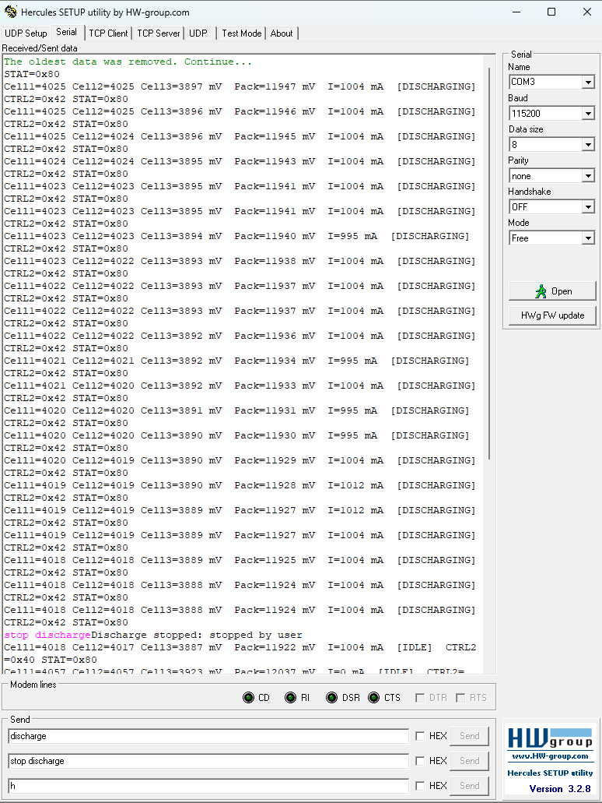
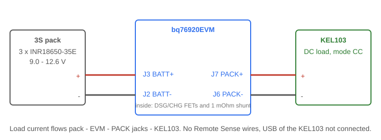
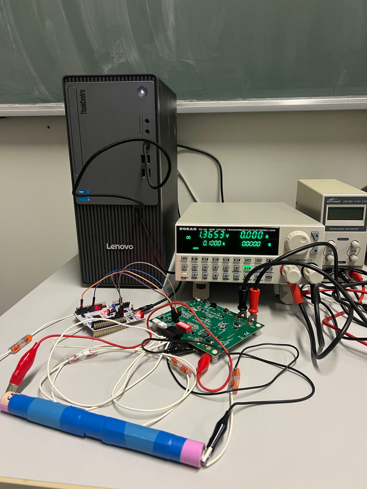

# 8.3 — BMS: Protected Discharge with the bq76920

**Board:** Nucleo-F446RE (STM32F446RETx) + bq76920EVM + Korad KEL103 DC load
**IDE:** STM32CubeIDE (GCC / make)

## Learning goal

This project teaches **how a battery pack is discharged safely under microcontroller control**: switch the discharge FET on a command, measure cells and current, and stop on the first limit that is broken.

After this project you can:
- explain how the bq76920 measures pack current with its coulomb counter and a shunt resistor
- switch the discharge FET with `DSG_ON` and read back why the chip itself cut it
- write a protection loop with undervoltage and overcurrent limits and a clear stop reason
- receive text commands over UART with an interrupt, without waiting for Enter

## Overview

The board prints every second. Send `discharge` to start and `stop discharge` to stop; the KEL103 sets the current.

```
3 cells found. Send "discharge" to start, "stop discharge" to stop
Cell1=4074 Cell2=4076 Cell3=3950 mV  Pack=12100 mV  I=0 mA  [IDLE]
Discharge started
Cell1=4020 Cell2=4022 Cell3=3890 mV  Pack=11932 mV  I=681 mA  [DISCHARGING]
Discharge stopped: cell voltage below cutoff (Cell3 = 2987 mV, limit 3000 mV)
Send "discharge" to start again
```

A 1 A test as seen in Hercules: the cells drop slowly, `I` stays near 1000 mA (the shunt step is about 8 mA), and `stop discharge` returns the line to `[IDLE]`.



Hardware and driver come from [8_1_BMS_Control](../8_1_BMS_Control) and the pack from [8_2](../8_2_BMS_PassiveBalancing); read 8.1 first.

## Theory

### Discharge path and the FETs

The load is not wired to the cells directly. It sits on `PACK+` and `PACK-` (`J7`, `J6`), and the current passes the **discharge FET** (DSG) and the **shunt** inside the EVM. After power-up the FET is off. The microcontroller sets bit `DSG_ON` (`0x02`) in `SYS_CTRL2` (`0x05`); clearing it cuts the load. Because the FET is in the current path, switching it off is the only protection that needs no load cooperation.

### Measuring current

The bq76920 has no ammeter. It integrates the voltage across a **shunt resistor** (R11 = 1 mΩ on the EVM) with a **coulomb counter**: with `CC_EN` (`0x40`) set in `SYS_CTRL2` the signed 16-bit register `CC_HI/CC_LO` (`0x32/0x33`) is refreshed every 250 ms, one step = 8.44 µV.

```
I [mA] = raw × 8.44 µV / 1 mΩ = raw × 8.44      example: raw = 80 → 675 mA
```

The same current flows through all three cells in series, so one value serves the whole pack. The chip reports charging as positive; the library negates it so discharge is positive. The step is about 8 mA, so 0.68 A is only about 80 steps and the displayed value jitters by a few mA.

### Limits and the stop rule

| Limit | Value | Reason shown |
|---|---|---|
| Any cell below | 3000 mV | cell voltage below cutoff |
| Pack below | 9000 mV | pack voltage below cutoff |
| Current above | 5000 mA | overcurrent |
| Chip flag `OCD`, `SCD`, `UV`, `OV` in `SYS_STAT` | — | protection of the bq76920 |

The pack is checked every 250 ms. A cell or pack undervoltage must hold for two samples so a noisy reading does not stop a discharge; overcurrent stops at once. The first limit broken switches `DSG_ON` off, prints the reason and stays stopped until the next `discharge` command. `BQ76920_MAX_DISCHARGE_MA` (4000 mA) is the rated current of this setup: above it the line shows a warning, above 5000 mA it stops. The current is read, never configured, so raising the KEL103 setting needs no code change.

### UART commands without Enter

`USART2` receives one byte at a time in an interrupt. The program keeps the last 14 characters and looks for the text at their end, so Hercules does not need to append a line ending. `stop discharge` is tested first because it also ends in `discharge`.

## Hardware & wiring

Wiring of the Nucleo and the pack is the same as [8.1](../8_1_BMS_Control#hardware--wiring): `PB8 (D15)` to `SCL`, `PB9 (D14)` to `SDA`, `GND`, on the left column of `J12` with its four shunts removed; the 3S pack on terminals `C0`, `C1`, `C2`, `C5`. Terminal: `115200, 8N1, no flow control`.




- Load wires on `J7 PACK+` and `J6 PACK-`, at least 1.5 mm², plus on plus. Do not connect Remote Sense or the USB cable of the KEL103.
- Set the KEL103 first (`Shift` + `CV` max current 4 A, `CV` max voltage 15 V, `CW` max power 60 W), then connect, then **CC** mode with `0.68` A. Switch the load output on only after `Discharge started`; with the FET off the load sees no pack.
- Open all `S3` DIP switches; press `Boot` once.

## CubeMX setup

Same as [8.1](../8_1_BMS_Control#cubemx-setup) with the project name `8_3_BMS_Discharge`, plus one step: **`USART2` → NVIC Settings → tick `USART2 global interrupt`**. Without it the receive callback never runs and the board ignores every command, with no error.

## Code

The `bq76920` library knows the chip; the `discharge` library knows the pack and the limits; `main.c` handles commands and printing. Write in `main.c` only between the `USER CODE BEGIN/END` markers; code outside them is lost when CubeMX regenerates ([which block holds what](../README.md#user-code-blocks)).

| Marker in `main.c` | Code |
|---|---|
| `Includes` | `<stdio.h>`, `<string.h>`, `<ctype.h>`, `bq76920.h`, `discharge.h` |
| `PV` | `buf`, `DIS_Pack pack`, `rx_byte`, `rx_tail`, `volatile command` |
| `0` | `send()`, `print_status()`, `print_stop()` |
| `2` | `BQ76920_Init`, `DIS_Detect`, `memset(rx_tail, ' ', ...)`, `HAL_UART_Receive_IT` |
| `3` | read `command`; 250 ms `DIS_Tick`; 1 s `print_status` |
| `4` | `HAL_UART_RxCpltCallback` |

### API

| Function | Parameters | Returns | Purpose |
|---|---|---|---|
| `BQ76920_ReadCurrent` | `int32_t *ma` | `HAL_StatusTypeDef` | Pack current, positive = discharge |
| `BQ76920_SetDischarge` | `uint8_t on` | `HAL_StatusTypeDef` | Set or clear `DSG_ON`, keep `CC_EN` |
| `BQ76920_ReadStatus` / `ClearStatus` | `uint8_t *stat` / `uint8_t mask` | `HAL_StatusTypeDef` | `SYS_STAT` flags, write 1 to clear |
| `DIS_Detect` | `DIS_Pack *p` | `HAL_StatusTypeDef` | Find the cells (3 to 5) and read once |
| `DIS_Start` | `DIS_Pack *p` | `DIS_Reason` | Refuse below a limit, else FET on |
| `DIS_Stop` | `DIS_Pack *p`, `DIS_Reason` | none | FET off and remember why |
| `DIS_Tick` | `DIS_Pack *p` | `uint8_t` | Read, apply limits, 1 = just stopped |

### Build order

Test every stage on the board before starting the next.

**Stage 1: current.** 1) set `CC_EN` in `SYS_CTRL2` at init; 2) read two bytes from `0x32` as `int16_t`; 3) multiply by 8440 and divide by the shunt in µΩ. *Test:* with the load off it reads about 0; with the load on it is positive and close to the KEL103 value. *Watch out:* if the sign is wrong, change `CC_INVERT` in `bq76920.c`.

**Stage 2: FET.** Keep a copy of `SYS_CTRL2` so setting `DSG_ON` never clears `CC_EN`.
```c
if (on) sys_ctrl2 |= 0x02; else sys_ctrl2 &= ~0x02;   /* DSG_ON */
write_reg(0x05, sys_ctrl2);
```
*Test:* `DSG_ON` on, KEL103 on: current flows; off: it stops.

**Stage 3: limits (`DIS_Tick`).** 1) read cells, pack sum and current; 2) read `SYS_STAT` and stop if a chip fault flag is set; 3) compare against the limits, the cutoffs with the two-sample rule; 4) on the first broken limit call `DIS_Stop`. *Watch out:* switch the FET off before anything that can fail, and use the absolute current.

**Stage 4: UART.** Re-arm `HAL_UART_Receive_IT` at the end of the callback, otherwise only the first byte arrives. The callback only sets `command`; the main loop acts on it.

**Stage 5: start rule (`DIS_Start`).** Refuse when a cell or the pack is already below its cutoff, clear all old `SYS_STAT` flags, then set `DSG_ON`.

Reference solution: [Core/Inc/bq76920.h](Core/Inc/bq76920.h), [Core/Src/bq76920.c](Core/Src/bq76920.c), [Core/Inc/discharge.h](Core/Inc/discharge.h), [Core/Src/discharge.c](Core/Src/discharge.c), [Core/Src/main.c](Core/Src/main.c).

## Folder structure

```
8_3_BMS_Discharge/
├── Core/
│   ├── Inc/
│   │   ├── bq76920.h                   - chip driver API, SYS_STAT flags, rated current
│   │   └── discharge.h                 - limits, stop reasons, pack type, API
│   └── Src/
│       ├── bq76920.c                   - registers, cells, current, DSG_ON, SYS_STAT
│       ├── discharge.c                 - cell detection, start rule, protection loop
│       └── main.c                      - UART commands, timing, printing
├── diagrams/                           - wiring, pack and load connection, test photo, Hercules screenshot
├── 8_3_BMS_Discharge.ioc               - CubeMX project (I2C1, USART2 with interrupt)
└── README.md
```
